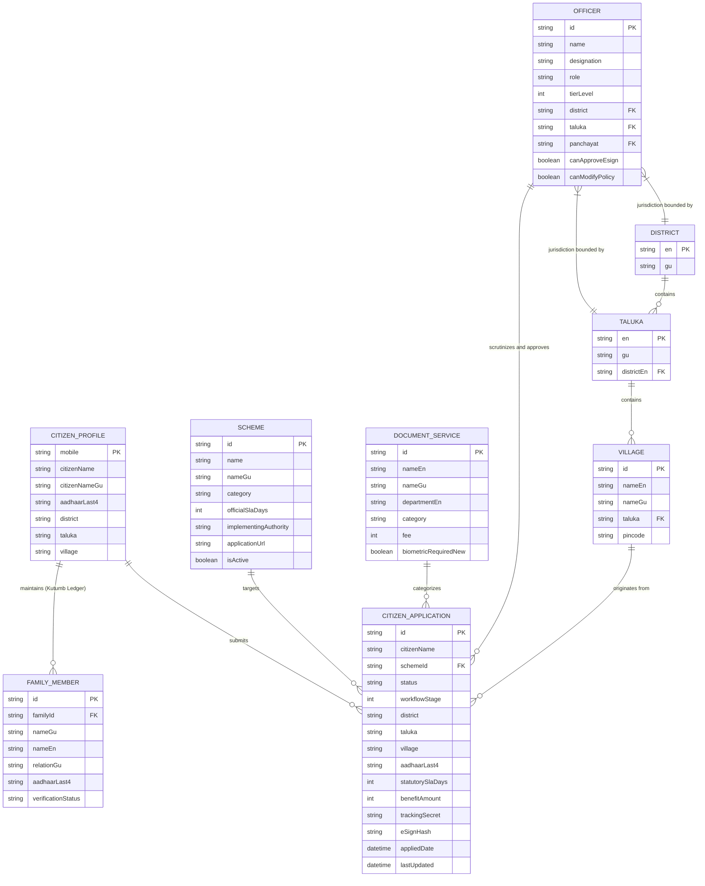

# 07 — DATABASE ARCHITECTURE & DATA MODEL SPECIFICATION
**Project:** NagrikSeva AI (નાગરિક સેવા AI)  
**Document Classification:** Database Schema, Firestore Collections, In-Memory Models, and ER Diagram  
**Storage Architecture:** Hybrid Multi-Tier (Google Cloud Firestore + Upstash Redis L1/L2 + In-Memory Datasets + LocalStorage)

---

## 1. Storage Architecture Overview

NagrikSeva AI avoids single-point-of-failure database dependencies by employing a **Hybrid Multi-Tier Storage Architecture**:
1. **Cloud Persistence (Google Cloud Firestore):** Manages dynamic citizen applications (`applications`), officer activity logs, and real-time public notices (`public_notices`).
2. **Distributed & Edge Caching (Upstash Redis & L1 LRU Cache):** High-speed in-memory cache (`src/lib/redis-cache.ts`) maintaining up to 5,000 entries with a 300-second TTL, delivering sub-millisecond response times for schemes and village lookups.
3. **Master Static In-Memory Datasets:** 5,420 realistic citizen applications in `large-datasets.ts`, 57 welfare schemes in `schemes-data.ts`, and 18,225 villages in `gujarat-geo-engine.ts`.
4. **Client-Side Offline Vaults:** Browser `localStorage` retaining active citizen sessions, Kutumb family ledgers, and submitted applications.

---

## 2. Entity-Relationship Diagram (ERD)

---

## 3. Data Entity Specifications

### 3.1 Entity: `CitizenApplication`
Represents an individual citizen request for a welfare benefit or statutory revenue certificate:

| Attribute | Data Type | Nullable | Description & Constraints |
| :--- | :--- | :--- | :--- |
| `id` | `string` | No | Primary Key (e.g., `APP005` or `APP-REV-2026-8941`). |
| `citizenName` | `string` | No | Applicant legal name in English script. |
| `citizenNameGu`| `string` | No | Applicant legal name in authentic Gujarati script. |
| `gender` | `enum` | No | `"male" \| "female"`. |
| `schemeId` | `string` | No | Foreign key linking to `SCHEMES_DATA.id` or `DOCUMENT_SERVICES.id`. |
| `schemeName` | `string` | No | Human-readable English title of the welfare service. |
| `schemeNameGu`| `string` | No | Human-readable Gujarati title of the welfare service. |
| `schemeEmoji` | `string` | No | Visual icon glyph representing the scheme category. |
| `district` | `string` | No | Revenue district name in English (e.g., `Rajkot`). |
| `districtGu` | `string` | No | Revenue district name in Gujarati (e.g., `રાજકોટ`). |
| `taluka` | `string` | No | Revenue taluka name in English (e.g., `Gondal`). |
| `village` | `string` | No | Revenue village / municipal ward (e.g., `Gomta`). |
| `aadhaarLast4`| `string` | No | Last 4 digits of applicant Aadhaar (DPDP compliant masking). |
| `status` | `enum` | No | `"approved" \| "processing" \| "pending" \| "rejected"`. |
| `workflowStage`| `integer`| No | Lifecycle stage: 1 (Submission), 2 (AI Scrutiny), 3 (Field Inquiry), 4 (Approved). |
| `appliedDate` | `string` | No | ISO 8601 date string of application submission. |
| `lastUpdated` | `string` | No | ISO 8601 date string of last officer action or status update. |
| `benefitAmount`| `number` | No | Monetary assistance or subsidy grant in INR. |
| `statutorySlaDays`| `number`| Yes | Statutory turnaround deadline under GRTSA 2013 (e.g., 7, 15, 30 days). |
| `remarksGu` | `string` | Yes | Official remarks in Gujarati entered by the scrutinizing officer. |
| `remarksEn` | `string` | Yes | Official remarks in English entered by the scrutinizing officer. |
| `officerDesignation`| `string`| Yes | Designation of the last reviewing or approving officer. |
| `trackingSecret`| `string`| Yes | Cryptographic secret for citizen privacy (e.g., `SEC-4921-GJ`). |
| `eSignHash` | `string` | Yes | 64-character SHA-256 digital signature stamp hash upon approval. |
| `paymentStatus`| `enum` | Yes | `"paid" \| "pending_challan" \| "free"`. |
| `feeAmount` | `number` | Yes | Statutory application fee in INR. |
| `txnId` | `string` | Yes | e-Grass treasury transaction reference number. |
| `digilockerVerified`| `boolean`| Yes | True if supporting documents were pulled via Rule 9A gateway. |
| `digilockerUri`| `string` | Yes | Uniform Resource Identifier issued by DigiLocker repository. |

---

### 3.2 Entity: `Scheme`
Defines welfare programs, benefits, and eligibility rules in `src/lib/schemes-data.ts`:

| Attribute | Data Type | Description |
| :--- | :--- | :--- |
| `id` | `string` | Unique alphanumeric identifier (e.g., `pm-kisan`, `ayushman-bharat`). |
| `name` | `string` | Official scheme title in English. |
| `nameGu` | `string` | Official scheme title in Gujarati. |
| `category` | `enum` | `"agriculture" \| "health" \| "housing" \| "education" \| "women" \| "business" \| "social" \| "energy"`. |
| `description` | `string` | Detailed narrative of scheme objectives and scope. |
| `benefits` | `string[]` | Array of enumerated financial and material benefits. |
| `eligibility` | `object` | Criteria object containing `minAge`, `maxAge`, `gender`, `incomeLimit`, `occupation`, `category`. |
| `documents` | `string[]` | Required proof checklist. |
| `officialSlaDays`| `number` | Statutory processing days mandated by Gujarat citizen charter. |
| `planningEstimateDays`| `string` | Platform digital delivery estimate (e.g., `"3-5 દિવસ"`). |
| `implementingAuthority`| `string`| Dedicated nodal authority or portal (e.g., `i-Khedut Portal`). |
| `applicationUrl`| `string` | External official portal application URL. |
| `isActive` | `boolean` | Flag controlling whether scheme is currently open for intake. |

---

### 3.3 Entity: `FamilyMemberProfile` (Kutumb Ledger)
Persisted locally and synchronized with state databases (`src/lib/family-ledger.ts`):

| Attribute | Data Type | Description |
| :--- | :--- | :--- |
| `id` | `string` | Member unique ID (e.g., `MEMBER-1728987123456`). |
| `nameGu` | `string` | Member full name in Gujarati. |
| `nameEn` | `string` | Member full name in English. |
| `relationGu` | `string` | Relationship to primary applicant (e.g., `પત્ની`, `પુત્ર`, `પિતા`). |
| `fatherOrHusbandNameGu`| `string`| Father or husband's full name. |
| `gender` | `enum` | `"male" \| "female"`. |
| `dob` | `string` | Date of birth (YYYY-MM-DD). |
| `age` | `number` | Computed age in completed years. |
| `aadhaarLast4` | `string` | Last 4 digits of member's Aadhaar. |
| `aadhaarMasked`| `string` | Masked Aadhaar string (e.g., `XXXX-XXXX-4921`). |
| `mobile` | `string` | 10-digit mobile number. |
| `verificationStatus`| `enum` | `"verified_same_mobile" \| "verified_other_mobile" \| "pending_otp"`. |
| `avatarEmoji` | `string` | Demographic emoji avatar. |

---

### 3.4 Entity: `OfficerNode`
Represents administrative actors in the 5-tier revenue hierarchy (`src/lib/admin-hierarchy-data.ts`):

| Attribute | Data Type | Description |
| :--- | :--- | :--- |
| `id` | `string` | Employee ID (e.g., `GUJ-GOV-9012`). |
| `name` | `string` | Officer full name and cadre suffix (e.g., `એચ. વી. પટેલ, GAS`). |
| `designation` | `string` | Official post (e.g., `તાલુકા મામલતદાર, ગોંડલ`). |
| `role` | `enum` | `"state_admin" \| "collector" \| "prant_officer" \| "mamlatdar" \| "talati"`. |
| `tierLevel` | `number` | 1 (State), 2 (District), 3 (Sub-Division), 4 (Taluka), 5 (Village). |
| `district` | `string` | Scoped revenue district (e.g., `Rajkot`). |
| `taluka` | `string` | Scoped revenue taluka (e.g., `Gondal`), null for Tiers 1 & 2. |
| `panchayat` | `string` | Scoped village panchayat (e.g., `Gomta`), Tier 5 only. |
| `canApproveEsign`| `boolean`| Authorization to digitally sign and issue final state certificates. |
| `canModifyPolicy`| `boolean`| Authorization to access dynamic CMS and modify system rules. |
| `canViewAllDistricts`| `boolean`| True only for Tier 1 State Admins. |

---

## 4. Caching Key Architecture & Redis Namespace

The L1 Edge In-Memory LRU Cache and Upstash Redis cluster use deterministic key naming patterns:

| Key Pattern | Default TTL | Invalidation Trigger | Contents |
| :--- | :--- | :--- | :--- |
| `schemes_master_all` | 300s (5m) | Scheme added/modified in CMS | Array of all 57 Scheme objects |
| `scheme_detail_${id}` | 600s (10m)| Single scheme update | Single deep Scheme specification |
| `kacheri_offices_master`| 300s (5m) | Kacheri updated in CMS | Directory of Gujarat administrative offices |
| `notices_public_list` | 180s (3m) | New notice published | Active public notices and circulars |
| `geo_villages_${district}_${taluka}`| 3600s (1h)| Static master | Array of village objects for specific taluka |
| `officer_session_${sessionId}` | 28800s (8h)| Logout or expiry | Deserialized officer permissions and jurisdiction |
