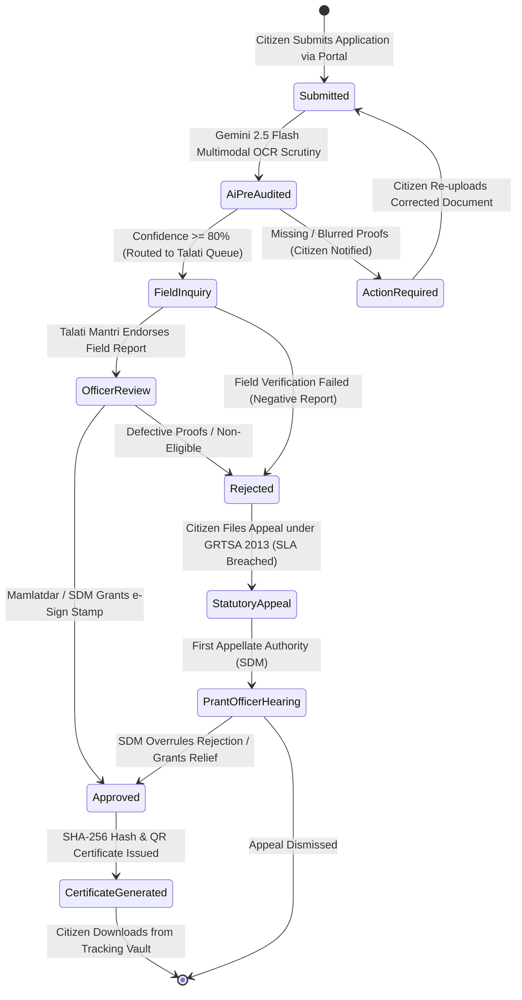
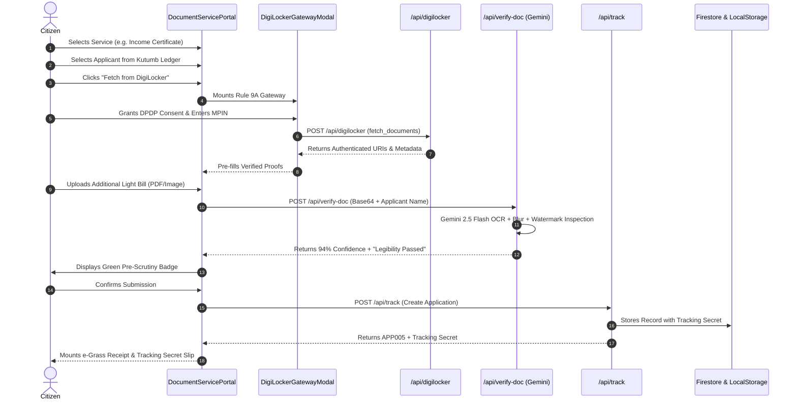
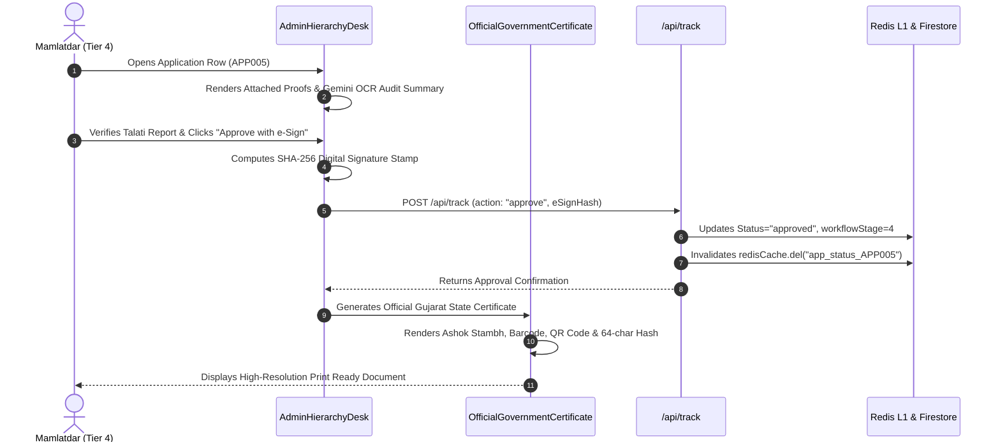

# 10 — END-TO-END WORKFLOWS & STATE LIFECYCLES
**Project:** NagrikSeva AI (નાગરિક સેવા AI)  
**Document Classification:** Execution Traces, State Transitions, and Mermaid Process Diagrams  
**Statutory Framework:** Gujarat Right to Services Act (GRTSA 2013) & IT Act Rule 9A

---

## 1. Application State Machine & Lifecycle Transitions

Every citizen application undergoes strict, deterministic state transitions as it moves from submission to statutory disposal:

---

## 2. Comprehensive Workflow Lifecycles

### 2.1 Workflow 1: Citizen 2FA Login & Kutumb Family Ledger Sync
1. **Trigger:** Citizen opens the portal and clicks "Login with Mobile / Aadhaar".
2. **Execution Steps:**
   - Citizen enters 10-digit mobile number and last 4 digits of Aadhaar.
   - Frontend calls `POST /api/auth/otp` (`action: "send_otp"`).
   - Server validates mobile format, generates a time-bound 6-digit OTP (demo sandbox: `123456`), and starts a 300-second expiry timer.
   - Citizen enters OTP and clicks "Verify".
   - Frontend calls `POST /api/auth/otp` (`action: "verify_otp"`).
   - Server cryptographically validates OTP against the active session challenge.
   - Upon success, the server retrieves the citizen's benefit profile and associated Kutumb family ledger (`family-ledger.ts`).
   - Profile is persisted to browser `localStorage` under `nagrik_citizen_session` and `nagrik_family_ledger`.
3. **Outcome:** Dynamic greeting card displays citizen's name in Gujarati, active applications count, and allows 1-click dependent switching.

---

### 2.2 Workflow 2: Citizen Application with DigiLocker & Gemini Vision AI Pre-Audit

---

### 2.3 Workflow 3: Cyber Treasury e-Grass Challan Settlement
1. **Trigger:** Service form reaches Step 4 (Payment Settlement).
2. **Execution Steps:**
   - Form calculates statutory fee (e.g., ₹20 for Revenue Services, ₹0 for Social Welfare).
   - Citizen selects payment method: "Cash at Jan Seva Kendra" or "Online Cyber Treasury (UPI)".
   - System invokes `GovernmentReceiptSlip.tsx`:
     - Generates 14-digit Challan Reference Number (CRN): `GJ-EGRASS-2026-XXXXXXXX`.
     - Allocates Major Revenue Budget Head: `0029 - Land Revenue` or `0059 - Stationery`.
     - Encodes CRN into standard Code 128 barcode.
     - Formats bilingual receipt displaying Treasury Seal, Depositor Copy, and Departmental Copy.
3. **Outcome:** Citizen downloads receipt PDF or presents physical CRN at the kacheri cash counter.

---

### 2.4 Workflow 4: 5-Tier Officer Scrutiny & Territorial Filtering
1. **Trigger:** Field officer logs into `/admin` using Employee ID and Security PIN.
2. **Execution Steps:**
   - `OfficerLoginShield.tsx` posts credentials to `/api/auth/otp`.
   - Server verifies credentials against `HIERARCHICAL_OFFICERS`, generates an HMAC-SHA256 session token, and sets the `nagrik_officer_token` cookie.
   - Portal loads `AdminHierarchyDesk.tsx`.
   - Client fetches applications from `/api/track` and local cache.
   - **Jurisdiction Scoping Rule:**
     - If Officer is Mamlatdar Gondal (Tier 4): Filters strictly where `app.taluka === "Gondal"`.
     - If Officer is Talati Gomta (Tier 5): Filters strictly where `cleanVillageOnly(app.village) === "ગોમટા"`.
   - **GRTSA 2013 SLA Watchdog:**
     - Computes elapsed time since `appliedDate`.
     - Compares elapsed days against `statutorySlaDays` (e.g., 7 days for Income).
     - Renders amber badge if remaining time < 48 hours; renders red flashing alert if deadline is breached.

---

### 2.5 Workflow 5: Officer e-Sign Stamp Approval & Certificate Issuance

---

### 2.6 Workflow 6: Application Rejection & Vernacular Explanation
1. **Trigger:** Scrutinizing officer identifies defective or falsified proofs.
2. **Execution Steps:**
   - Officer clicks "Reject Application" in `AdminHierarchyDesk.tsx`.
   - Modal presents standard administrative rejection categories:
     - Identification proof blurred / unreadable.
     - Ration card member list mismatch.
     - Domicile / pedigree proof missing.
   - Officer enters specific remarks or selects standard template.
   - `translateRejectionToGujarati()` (`admin-hierarchy-data.ts`) translates administrative jargon into polite, actionable Gujarati guidance:
     - Gujarati Title: *"ઓળખ પુરાવો (આધાર કાર્ડ) અસ્પષ્ટ"*
     - Explanation: *"તમારા આધાર કાર્ડની બંને બાજુનો ફોટો યોગ્ય પ્રકાશમાં વંચાય તેવો નથી..."*
     - Next Step: *"આધાર કાર્ડનો સ્પષ્ટ ઓરિજિનલ કલર ફોટો અપલોડ કરીને ફરીથી સબમિટ કરો."*
   - Status transitions to `rejected` with `correctionsRequested` array populated.
3. **Outcome:** Citizen receives transparent feedback in the tracking vault with a 1-click re-upload button.

---

### 2.7 Workflow 7: Citizen Tracking & Statutory SLA Appeal Filing
1. **Trigger:** Citizen visits `/track` to verify application status.
2. **Execution Steps:**
   - Citizen enters Application ID (e.g., `APP003`) and private Tracking Secret (`SEC-3310-GJ`).
   - System retrieves application record.
   - If statutory SLA days have elapsed and status is still `pending` or `processing`:
     - System displays high-visibility warning: *"કાયદાકીય સમયમર્યાદા (SLA) પૂર્ણ થયેલ છે"*.
     - Activates **"File 1-Click Statutory Appeal under GRTSA 2013"** button.
   - Citizen clicks "File Appeal":
     - System automatically drafts an official appeal addressed to the **Sub-Divisional Magistrate / Prant Officer (First Appellate Authority)**.
     - Application priority is upgraded to `CRITICAL_ESCALATION` in the officer queue.
3. **Outcome:** File is highlighted in red at the Prant Officer's desk for immediate intervention.

---

### 2.8 Workflow 8: Dynamic Admin CMS Updating
1. **Trigger:** State Admin or District Collector modifies an existing scheme or circular.
2. **Execution Steps:**
   - Officer navigates to "Policy & Dynamic CMS" tab in `AdminHierarchyDesk.tsx`.
   - Selects "Welfare Schemes CMS" or "Public Notices CMS" in `AdminPortalCmsManager.tsx`.
   - Modifies scheme benefit amount, eligibility age, or uploads a new government circular PDF.
   - Clicks "Save Changes to State CMS":
     - Client dispatches `nagrik_notices_updated` DOM event across browser tabs.
     - Posts update to `/api/schemes` or `/api/notices`.
     - Server updates Firestore and executes `redisCache.del("schemes_master_all")`.
3. **Outcome:** All citizens querying the portal see the updated rules and circulars within milliseconds without application redeployment.

---

### 2.9 Workflow 9: Chief Secretary BI Analytics & Machine Learning Delay Prediction
1. **Trigger:** Tier 1 State Admin selects "Secretariat Apex BI" tab.
2. **Execution Steps:**
   - Mounts `SecretariatApexBiDashboard.tsx`.
   - Loads 6-month historical intake and disposal datasets (October 2025 – March 2026).
   - Invokes `getSecretariatMlForecast()` (`src/lib/historical-ml-engine.ts`):
     - Executes linear regression ($R^2 = 0.941$).
     - Predicts next month's statewide intake volume (184,000 files, +5.4% growth).
     - Ranks all 33 districts on on-time disposal velocity (Rajkot: 99.2%, Surat: 98.8%, Dang: 91.5%).
     - Highlights high-risk talukas and schemes with predicted breach probability (e.g., Rural Housing at 8.4% risk).
3. **Outcome:** Principal Secretaries can reallocate contractual operators or issue corrective notices prior to administrative backlogs forming.
