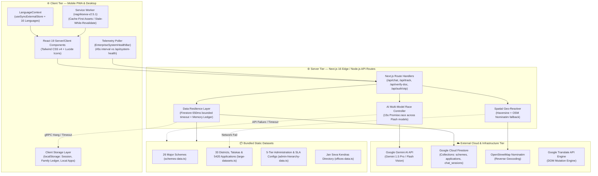
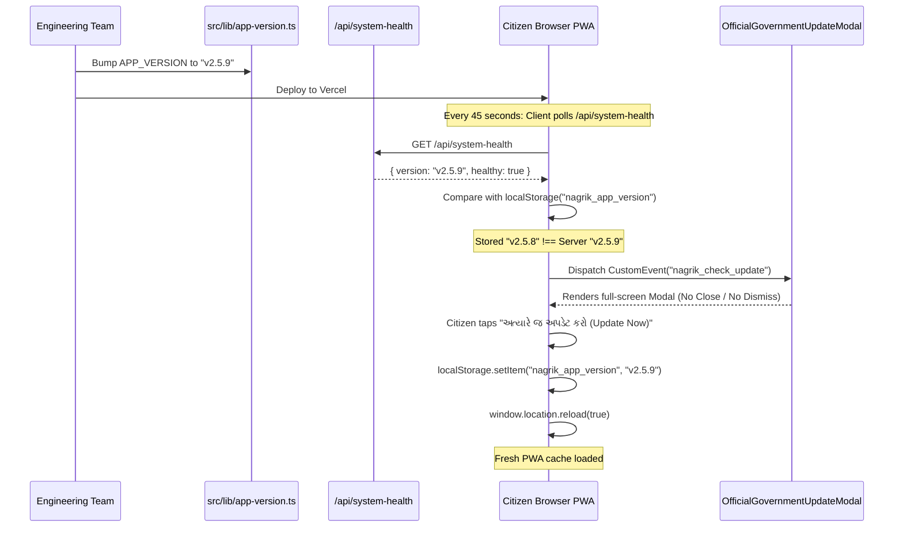

# 02 — System Architecture & Design Patterns

---

## 1. High-Level Architecture Overview

NagrikSeva AI follows a **Decoupled Edge-Resilient Architecture** engineered on Next.js 16 (App Router) and React 19. Because civic tech applications deployed in rural Gujarat must withstand unpredictable mobile networks, slow 2G/3G connections, and cloud API throttling, the system is designed with **dual-pathway execution** across every major tier:



---

## 2. Frontend / Backend Architectural Boundaries

Under Next.js 16 App Router, the boundaries between client and server are strictly defined by React Server Components (RSC) and Client Components (`"use client"`):

1. **Client Components:**
   - All interactive forms, dialogs, portals, and dynamic state containers carry the `"use client"` directive.
   - Key examples: [`UnifiedCitizenPortal.tsx`](file:///d:/Movies%20and%20Web%20se/atmiya/nagrik-seva/src/components/UnifiedCitizenPortal.tsx), [`DocumentServicePortal.tsx`](file:///d:/Movies%20and%20Web%20se/atmiya/nagrik-seva/src/components/DocumentServicePortal.tsx), [`ChatBot.tsx`](file:///d:/Movies%20and%20Web%20se/atmiya/nagrik-seva/src/components/ChatBot.tsx), [`AdminHierarchyDesk.tsx`](file:///d:/Movies%20and%20Web%20se/atmiya/nagrik-seva/src/components/AdminHierarchyDesk.tsx).
   - They handle browser events (`window.print()`, `navigator.vibrate()`, `localStorage`, `sessionStorage`, `SpeechSynthesis`).
2. **Server Handlers (API Routes):**
   - Reside strictly in `src/app/api/*/route.ts`.
   - Never expose API keys (e.g., `GOOGLE_GENAI_API_KEY`, `FIREBASE_PRIVATE_KEY`) to the client browser.
   - Perform heavy string parsing, regex extraction, external API dispatch, and database reads/writes.
3. **Static Data Libraries:**
   - Bundled in `src/lib/` and imported interchangeably across server routes and client components for instantaneous edge rendering.

---

## 3. The 5 Core Resilience & Fallback Patterns

### 3.1 AI Orchestration & Multi-Model Racing Pattern
Located in [`src/app/api/chat/route.ts`](file:///d:/Movies%20and%20Web%20se/atmiya/nagrik-seva/src/app/api/chat/route.ts#L635-L674):
When a citizen sends a prompt:
1. The server iterates through a candidate list of high-speed Gemini models:
   `["gemini-flash-lite-latest", "gemini-3.5-flash-lite", "gemini-3.7-flash", "gemini-3.8-flash"]`.
2. Each model request is raced against a strict `15,000ms` `Promise.race` timeout:
   ```typescript
   const sendPromise = chat.sendMessage(trimmedMsg + systemPromptSuffix);
   const timeoutPromise = new Promise((_, reject) =>
     setTimeout(() => reject(new Error(`Timeout on model ${modelName}`)), 15000)
   );
   const result = await Promise.race([sendPromise, timeoutPromise]);
   ```
3. If an external model succeeds, its token stream is returned immediately.
4. If all external candidates timeout or fail (e.g., quota limits or 503 spikes), the server executes `getLocalFallbackReply()`. This function parses the citizen's prompt using deterministic regex keyword matching, returning an authentic administrative response citing official government acts (NFSA 2013, GRTSA 2013, PM-KISAN, PM-JAY) and actionable buttons.

### 3.2 Non-Blocking Firestore Persistence Pattern
Located in [`src/app/api/track/route.ts`](file:///d:/Movies%20and%20Web%20se/atmiya/nagrik-seva/src/app/api/track/route.ts#L47-L53,L200-L240):
During citizen application submission or fee payment:
1. Firebase Firestore's Web SDK can occasionally hang if gRPC connections disconnect (`Code: 14 UNAVAILABLE: EHOSTUNREACH`).
2. To prevent blocking the citizen's HTTP payment request, the API writes immediately (`0ms`) into the server's in-memory ledger (`addCustomApplication`).
3. Firestore `setDoc()` is dispatched **asynchronously in the background**:
   ```typescript
   setDoc(fsDoc(db, "applications", id), cleanForFirestore(newApp))
     .catch(err => console.warn("Background Firestore sync deferred:", err));
   ```
4. Read requests wrap Firestore calls with `withFirestoreTimeout(promise, 650ms)`:
   ```typescript
   function withFirestoreTimeout<T>(promise: Promise<T>, ms = 650): Promise<T | null> {
     return Promise.race([
       promise,
       new Promise<null>((resolve) => setTimeout(() => resolve(null), ms)),
     ]);
   }
   ```
   If Firestore does not respond within 650ms, the system falls back to the in-memory dataset, ensuring sub-second response times.

### 3.3 Client Quota-Safe LocalStorage Synchronization
Located in [`src/components/DocumentServicePortal.tsx`](file:///d:/Movies%20and%20Web%20se/atmiya/nagrik-seva/src/components/DocumentServicePortal.tsx#L886-L919):
1. Citizens uploading high-resolution photos (2MB–5MB) can easily exceed the browser's 5MB `localStorage` limit.
2. The application sanitizes the application object before caching it in `localStorage` under `"nagrik_user_applications"`:
   - Base64 images are stripped or limited to lightweight thumbnails.
   - Applications are stored with unique ID deduplication so newly created applications instantly appear in the citizen's *Track Vault* even before server synchronization.

### 3.4 Hybrid Language Translation Engine
Located in [`src/context/LanguageContext.tsx`](file:///d:/Movies%20and%20Web%20se/atmiya/nagrik-seva/src/context/LanguageContext.tsx) and [`src/lib/translation.ts`](file:///d:/Movies%20and%20Web%20se/atmiya/nagrik-seva/src/lib/translation.ts):
The platform implements a two-tier translation strategy:
1. **Tier 1 (Native Context - Zero Latency):** Gujarati (`gu`), Hindi (`hi`), and English (`en`) are natively translated through React state (`useLanguage()`). React components re-render immediately with pre-compiled strings.
2. **Tier 2 (DOM-Level Translation - 13 Additional Languages):** Tamil, Telugu, Bengali, Marathi, Punjabi, Kannada, Malayalam, Odia, Assamese, Urdu, Sanskrit, Konkani, and Maithili are translated dynamically by the Google Translate DOM engine.
3. **State Synchronization:** `useSyncExternalStore` subscribes to `"nagrikseva:languageChange"` and browser `storage` events, ensuring that language selection remains in sync across multiple browser tabs and mobile viewports.
4. **Strict Policy:** Content-carrying elements strictly omit the `notranslate` class to enable 100% full-page translation.

### 3.5 Telemetry & Un-Bypassable Forced-Update Pipeline
Located in [`src/components/EnterpriseSystemHealthBar.tsx`](file:///d:/Movies%20and%20Web%20se/atmiya/nagrik-seva/src/components/EnterpriseSystemHealthBar.tsx) and [`src/components/OfficialGovernmentUpdateModal.tsx`](file:///d:/Movies%20and%20Web%20se/atmiya/nagrik-seva/src/components/OfficialGovernmentUpdateModal.tsx):
Government security standards require that no citizen operates an outdated client version with stale policy rules or expired benefit criteria:



---

## 4. Cross-Module Communication & Event Bus

The frontend coordinates asynchronous state across disparate components using browser CustomEvents without incurring Redux or heavy external state library overhead:

| Event Name | Dispatched By | Listened By | Purpose |
| :--- | :--- | :--- | :--- |
| `nagrik_auth_change` | `CitizenLoginShield`, `Navbar` | `UnifiedCitizenPortal`, `MobileGreetingCard` | Signals citizen login, logout, or session renewal. |
| `nagrik_family_updated` | `FamilyMemberManagerBar` | `DocumentServicePortal`, `CitizenPortalHeader` | Notifies that a new family member has been added or consent verified. |
| `nagrik_family_member_change`| `FamilyMemberManagerBar` | `DocumentServicePortal` | Triggers auto-prefill of active applicant fields when switching from Self to Father/Mother/Child. |
| `nagrik_check_update` | `EnterpriseSystemHealthBar` | `OfficialGovernmentUpdateModal` | Forces open the mandatory update modal upon version mismatch. |
| `nagrikseva:languageChange` | `LanguageSelector` | `LanguageContext` | Re-renders UI text and updates cookies across tabs. |
