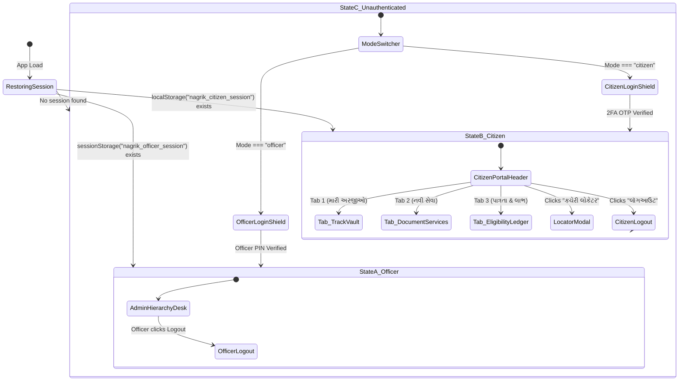

# 04 — Frontend Guide & Navigation Architecture

---

## 1. Frontend Framework & Tooling

- **Core Framework:** Next.js `16.3.6` (App Router with React Server Components & Client Components).
- **UI Library:** React `19.2.8`.
- **Language:** TypeScript `5.x` (Strict mode enabled).
- **Styling Architecture:** Tailwind CSS `v4` with `@tailwindcss/postcss`.
- **Iconography:** Lucide React (`1.48.0`).
- **Typography:** Inter sans-serif typeface with native Gujarati unicode support.
- **Color System:** Tricolor Indian Government Palette:
  - Saffron / Orange: `#ea580c` (`orange-600`), `#f97316` (`orange-500`)
  - Emerald / Green: `#16a34a` (`green-600`), `#10b981` (`emerald-500`)
  - Deep Slate / Ashoka Blue: `#0f172a` (`slate-900`), `#0369a1` (`sky-700`)

---

## 2. Global Initialization & Root Layout (`src/app/layout.tsx`)

When the application boots in a browser or PWA viewport, `src/app/layout.tsx` wraps the document in global foundational providers:

```
<html>
  <body>
    <LanguageProvider>                      # LanguageContext (16 Indian Languages)
      <AppSplashScreen />                   # 2.5s WhatsApp-style startup animation
      <OfficialGovernmentUpdateModal />     # Forced update listener
      <ServiceWorkerRegister />             # Registers public/sw.js
      <HapticFeedbackProvider />            # Listens to data-haptic touch clicks
      <GlobalModalScrollLocker />           # Controls document overflow
      <ScrollRestoration />                 # Preserves scroll position across routes
      <EnterpriseSystemHealthBar />         # Telemetry ticker & 45s health poller
      {children}                            # Route-specific page content
      <Footer />                            # Multilingual footer with team credits
      <MobileBottomNav />                   # 5-Tab fixed bottom navigation (mobile only)
      <FloatingInstallBanner />             # PWA install prompt banner
      <InstallAppModal />                   # Platform-specific install modal
      <GoogleTranslateScript />             # Dynamic script loader for 13 non-native langs
    </LanguageProvider>
  </body>
</html>
```

---

## 3. Route Map & Page Navigation Structure

The application defines 11 user-facing routes:

```
/                             → Homepage (Hero, Greeting Card, Quick Grid, Featured Schemes)
├── /portal                   → Citizen Single Sign-On Gateway (Default: Track Vault)
├── /track                    → Application Status Vault & GRTSA SLA Countdown
├── /documents                → 69+ Government Document Services Application Wizard
├── /eligibility              → Welfare Scheme Eligibility Matching Ledger
├── /admin                    → 5-Tier Officer Administrative Hierarchy Desk
├── /chat                     → Full-Screen Multilingual Gemini AI Civic Assistant
├── /schemes                  → 26+ Government Welfare Schemes Directory
│   └── /schemes/[id]         → Dynamic Scheme Detail & Instant Application Modal
├── /benefit-calculator       → Family Annual Entitlement Calculator & Welfare Pass
└── /locator                  → Jan Seva Kendra & Mamlatdar Kacheri Locator
```

---

## 4. The Unified Citizen Portal State Machine (`UnifiedCitizenPortal.tsx`)

The core of the authenticated experience is [`UnifiedCitizenPortal.tsx`](file:///d:/Movies%20and%20Web%20se/atmiya/nagrik-seva/src/components/UnifiedCitizenPortal.tsx), which operates as an un-gated **Tri-Modal State Machine**:



---

## 5. Screen-by-Screen User Interaction Walkthrough

### 5.1 Homepage (`src/app/page.tsx`)
- **Desktop View:** Displays the Indian tricolor hero banner, quick tools strip, live statistics (`26+ યોજનાઓ`, `16 ભાષાઓ`, `24/7 AI`), and 6 featured schemes with quick-apply buttons.
- **Mobile View (Super-App Paradigm):**
  1. [`MobileGreetingCard.tsx`](file:///d:/Movies%20and%20Web%20se/atmiya/nagrik-seva/src/components/MobileGreetingCard.tsx): Displays dynamic greeting (`નમસ્તે, હરિ પટેલ!`) with verified DigiLocker badge.
  2. PhonePe/UMANG 4-Column Tool Grid: `પાત્રતા` (`/eligibility`), `લાભ ગણો` (`/benefit-calculator`), `અરજી ટ્રેક` (`/track`), `દસ્તાવેજ` (`/documents?type=ration`). Designed with zero duplication against the bottom navigation.
  3. Interactive embedded AI chat preview.

### 5.2 69+ Document Service Portal (`DocumentServicePortal.tsx`)
- **Step 1 — Service Selection:** Filter 69+ services across Revenue, Panchayat, Social Welfare, and Food & Civil Supplies.
- **Step 2 — DigiLocker Pre-fill:** Tapping "માહિતી લાવો" auto-fetches name, father's name, DOB, address, and mobile.
- **Step 3 — Family Member Management:** Head of family selects active member (`હરી પટેલ`, `વિનોદરાઈ`, etc.) from [`FamilyMemberManagerBar.tsx`](file:///d:/Movies%20and%20Web%20se/atmiya/nagrik-seva/src/components/FamilyMemberManagerBar.tsx).
- **Step 4 — Document Upload & AI Smart Check:**
  - Citizen uploads image or PDF.
  - Client sends base64 to `/api/verify-doc`.
  - While processing, displays `🔄 Gemini AI દસ્તાવેજ ચકાસી રહ્યું છે...`.
  - Returns instant green badge (`પ્રમાણિત (90%): માન્ય દસ્તાવેજ`) or red warning.
- **Step 5 — Phygital Signature:** Citizen chooses between Aadhaar eSign or Physical Declaration.
- **Step 6 — Cyber Treasury Payment:** Modal opens with UPI QR code, Cards, or Cash Challan. Upon submit, completes within 1s and triggers [`GovernmentReceiptSlip.tsx`](file:///d:/Movies%20and%20Web%20se/atmiya/nagrik-seva/src/components/GovernmentReceiptSlip.tsx).

### 5.3 Application Track Vault (`TrackVaultView.tsx`)
- Queries in-memory ledger and Cloud Firestore.
- Displays applications in responsive cards (`grid-cols-3` mobile tabs).
- Each card shows: Application ID (`APP-GUJ-8038`), Scheme Name, District/Taluka, Stage indicator (1 to 5), and SLA Countdown Badge (`૭૨ કલાકમાં નિકાલ કાયદાકીય ફરજિયાત`).
- Action buttons:
  - `👁️ ટાઈમલાઈન`: Opens detailed step progression through Mamlatdar, Talati, and SDM desks.
  - `📄 રસીદ`: Opens printable government receipt slip.
  - `🏆 પ્રમાણપત્ર`: Opens official downloadable A4 Certificate or PVC card.

### 5.4 Officer Administrative Hierarchy Desk (`AdminHierarchyDesk.tsx`)
- **Administrative Filters:** Dropdowns for District (33 districts), Taluka, Village, and Application Status.
- **Application Table / Cards:** Shows citizen name, photo thumbnail, submission date, current stage, and AI document score.
- **Officer Scrutiny Drawer:**
  - Allows inspecting uploaded documents side-by-side.
  - Displays OCR extracted name, document number, and AI validation checklist.
  - Stage advance dropdown (e.g., from *ચકાસણી ચાલુ* to *મંજૂર*).
  - Operator cash fee confirmation button (`રોકડ ફી સ્વીકારો`).

### 5.5 Annual Benefit Calculator (`src/app/benefit-calculator/page.tsx`)
- Step 1: Input Aadhaar and Mobile -> Verify 6-digit OTP.
- Step 2: Auto-loads family roster (Head, Spouse, Parents, Children).
- Step 3: Interactive toggle chips for farmer status, housing, gas, girl child, senior citizen, and student.
- Step 4: Displays real-time entitlement total (e.g., `₹2,35,000 પ્રતિ વર્ષ`) with breakdown:
  - Direct Benefit Transfer (DBT Cash)
  - Subsidy & Grants
  - Health & Accident Insurance Cover
- Step 5: Tapping "અધિકાર પાસ જુઓ" renders the printable *રાષ્ટ્રીય કલ્યાણ અધિકાર પાસ* with QR code.

---

## 6. Mobile Optimization & Haptic Design

1. **Bottom Navigation (`MobileBottomNav.tsx`):** Fixed 5-tab bar on mobile devices (`Home`, `Schemes`, `AI Chat`, `Offices`, `Portal`). Automatically hides on desktop screens (`sm:hidden`).
2. **Notch & Safe Area Compliance:** Uses `pb-[calc(4.5rem+env(safe-area-inset-bottom,0px))]` to prevent content from being obscured by iPhone home indicators or Android gesture bars.
3. **Touch Haptics (`HapticFeedbackProvider.tsx`):** Intercepts touch clicks on interactive cards and buttons, invoking `navigator.vibrate(10)` for realistic native-app tactile feedback.
4. **Body Scroll Lock (`useBodyScrollLock.ts`):** Freezes background `document.body.style.overflow = 'hidden'` whenever any modal, receipt, certificate, or image preview is active.
