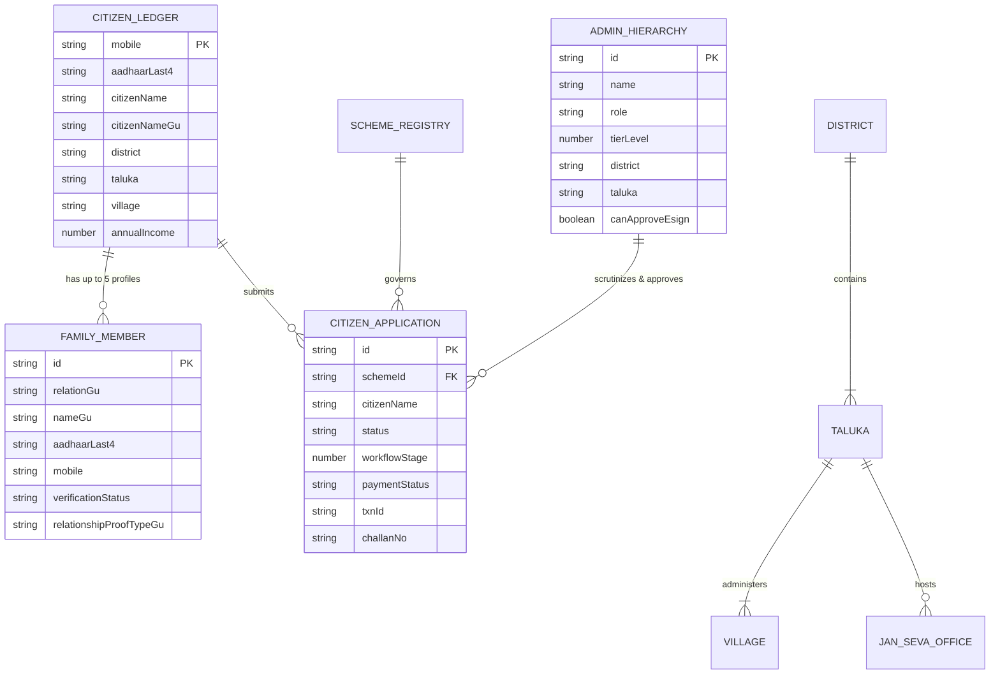

# 07 — Database Schema & Data Models

---

## 1. Data Layer Overview

NagrikSeva AI operates with a **Tiered Storage Model** composed of:
1. **Cloud Persistence (Google Cloud Firestore):** NoSQL document store hosting active schemes, submitted citizen applications, and conversation session logs.
2. **Server Edge Ledger (In-Memory Runtime Store):** Fast, in-memory structures (`addCustomApplication`, `queryApplications`) that pre-load and cache records to eliminate latency and survive cloud disconnections.
3. **Bundled Static Administrative Registries:** Type-safe TypeScript registries defining Gujarat's revenue geography, 26 schemes, 5-tier officer hierarchy, and 69+ services.
4. **Client Local Storage Vault:** Browser `localStorage` retaining active session credentials, the Kutumb family ledger, and offline application mirrors.

---

## 2. Cloud Firestore Collections Schema

### 2.1 Collection: `schemes`
Stores official welfare scheme configurations. Populated via `scripts/seed-firestore.mjs`.

| Field Name | Type | Nullable | Description |
| :--- | :--- | :--- | :--- |
| `id` (Document ID) | `string` | No | Unique slug (e.g., `pm-kisan`, `ayushman-bharat`). |
| `name` | `string` | No | English official name. |
| `nameGu` | `string` | No | Gujarati official name. |
| `nameHi` | `string` | Yes | Hindi official name. |
| `category` | `string` | No | Category enum (`agriculture`, `health`, `housing`, etc.). |
| `description` | `string` | No | Summary of scheme objectives. |
| `benefits` | `string[]` | No | Array of financial or in-kind entitlement bullets. |
| `eligibility` | `map` | No | Structured eligibility rules (`minAge`, `maxAge`, `incomeLimit`, `occupation`, `category`). |
| `documents` | `string[]` | No | Checklist of required supporting proofs. |
| `applicationUrl` | `string` | Yes | External official portal URL. |
| `icon` | `string` | No | Emoji or icon identifier. |
| `ministry` | `string` | No | Sponsoring department or ministry. |
| `isActive` | `boolean` | No | Flag indicating if citizens can apply. |
| `views` | `number` | Yes | View counter metric. |

### 2.2 Collection: `applications`
Stores submitted citizen applications for certificates and schemes.

| Field Name | Type | Nullable | Description |
| :--- | :--- | :--- | :--- |
| `id` (Document ID) | `string` | No | Application ID format: `APP-GUJ-XXXX` (e.g., `APP-GUJ-8038`). |
| `citizenName` | `string` | No | Applicant's English full name. |
| `citizenNameGu` | `string` | No | Applicant's Gujarati full name. |
| `gender` | `string` | No | `"male"` \| `"female"`. |
| `schemeId` | `string` | No | Identifier matching the scheme or document service. |
| `schemeName` | `string` | No | Name of the applied certificate or scheme. |
| `schemeNameGu` | `string` | No | Gujarati name of the scheme. |
| `district` | `string` | No | District of jurisdiction (e.g., `"Rajkot"`). |
| `taluka` | `string` | No | Taluka of jurisdiction (e.g., `"Gondal"`). |
| `village` | `string` | No | Village name (e.g., `"Gomta"`). |
| `aadhaarLast4` | `string` | No | Masked Aadhaar identifier (last 4 digits). |
| `mobile` | `string` | Yes | 10-digit primary citizen contact number. |
| `status` | `string` | No | State enum: `"approved"` \| `"processing"` \| `"pending"` \| `"rejected"`. |
| `workflowStage` | `number` | No | Current desk: `1` (Submitted), `2` (Scrutiny), `3` (Field Check), `4` (Approved). |
| `appliedDate` | `string` | No | ISO date string (`YYYY-MM-DD`). |
| `lastUpdated` | `string` | No | ISO date string of latest stage change. |
| `benefitAmount` | `number` | No | Financial grant value in INR. |
| `feeAmount` | `number` | Yes | Government fee in INR. |
| `paymentStatus` | `string` | No | `"paid"` \| `"pending_challan"` \| `"free"`. |
| `paymentMethod` | `string` | Yes | `"upi"` \| `"card"` \| `"challan"`. |
| `txnId` | `string` | Yes | Cyber Treasury payment transaction ID. |
| `challanNo` | `string` | Yes | Official e-Grass Challan number (`GRN-2026-XXXXX`). |
| `officerDesignation` | `string` | No | Current handling officer desk description. |
| `remarksGu` | `string` | No | Official Gujarati case remarks. |
| `documentsVerified`| `array` | Yes | Array of `{ name, verified: boolean, qualityScore: number }`. |
| `citizenPhoto` | `string` | Yes | Base64 thumbnail of applicant (stripped if >120KB for quota safety). |

### 2.3 Collection: `chat_sessions`
Stores conversation sessions between citizens and Gemini AI.

| Field Name | Type | Nullable | Description |
| :--- | :--- | :--- | :--- |
| `id` (Document ID) | `string` | No | Unique session UUID. |
| `title` | `string` | No | Conversation topic title. |
| `citizenId` | `string` | No | Authenticated citizen mobile or `"guest"`. |
| `citizenName` | `string` | Yes | Display name of the citizen. |
| `messages` | `array` | No | Array of `Message` objects (`role`, `text`, `timestamp`, `actionButtons`). |
| `createdAt` | `string` | No | ISO creation timestamp. |
| `updatedAt` | `string` | No | ISO update timestamp. |

---

## 3. In-Memory Static Models & Relational Cardinality



---

## 4. Security Rules & Access Patterns (`firestore.rules`)

The production Firestore security rules ([`firestore.rules`](file:///d:/Movies%20and%20Web%20se/atmiya/nagrik-seva/firestore.rules)) strictly enforce read-only public access:

```
rules_version = '2';
service cloud.firestore {
  match /databases/{database}/documents {
    match /schemes/{schemeId} {
      allow read: if true;
      allow write: if false;
    }
    match /{document=**} {
      allow read: if true;
      allow write: if false;
    }
  }
}
```

**Architectural Implication:**
- Direct unauthenticated client-side mutations (`setDoc`, `updateDoc`, `deleteDoc`) directly from the browser SDK are rejected by Firestore security rules.
- All writes are executed via server-side API routes (`/api/track`, `/api/chat/history`), ensuring that application validation, quota sanitization, and permission checks are enforced prior to storage.
