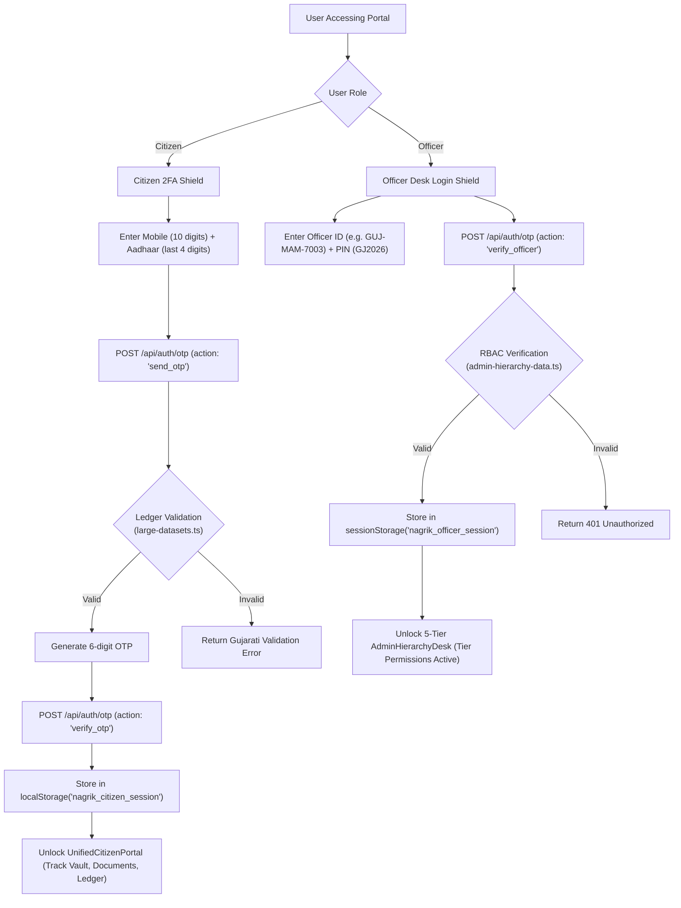

# 08 — Authentication, Authorization & Security Architecture

---

## 1. Authentication Systems Overview

NagrikSeva AI enforces two distinct authentication pathways depending on user domain:

---

## 2. Session Management & Storage Boundaries

| Session Type | Storage Mechanism | Storage Key | Expiration / Scope | Rationale |
| :--- | :--- | :--- | :--- | :--- |
| **Citizen Session** | Browser `localStorage` | `nagrik_citizen_session` | Persistent across browser sessions until explicit logout. | Ensures rural citizens on mobile phones remain logged in without repeated OTP fatigue. |
| **Active Family Member** | Browser `localStorage` | `nagrik_active_family_member` | Persistent. | Remembers the selected family profile (Self, Father, Spouse) across navigation. |
| **Officer Session** | Browser `sessionStorage` | `nagrik_officer_session` | Tab / Window lifetime only (auto-cleared on tab close). | Government security compliance: prevents shared terminal leakage at Mamlatdar desks. |
| **App Version Tag** | Browser `localStorage` | `nagrik_app_version` | Updated upon forced update confirmation. | Evaluates version mismatch against `/api/system-health`. |

---

## 3. Role-Based Access Control (RBAC) & Administrative Hierarchy

Officer capabilities are enforced through a strict 5-tier role model configured in [`src/lib/admin-hierarchy-data.ts`](file:///d:/Movies%20and%20Web%20se/atmiya/nagrik-seva/src/lib/admin-hierarchy-data.ts#L11-L43):

| Tier Level | Role Name | Designation Examples | Can Approve eSign? | Can Verify Payment? | Can Modify Policy? | Can View All Districts? |
| :--- | :--- | :--- | :--- | :--- | :--- | :--- |
| **Tier 1** | `state_admin` | Additional Chief Secretary (Revenue), Gandhinagar | ✅ Yes | ✅ Yes | ✅ Yes | ✅ Yes (All 33) |
| **Tier 2** | `district_collector` | District Collector & DM, Rajkot | ✅ Yes | ✅ Yes | ✅ Yes | ❌ District Only |
| **Tier 3** | `sdm_prant` | Sub-Divisional Magistrate / Prant Officer, Gondal | ✅ Yes | ✅ Yes | ❌ No | ❌ Sub-Division Only |
| **Tier 4** | `mamlatdar` | Taluka Mamlatdar & Executive Magistrate, Gondal | ✅ Yes | ✅ Yes | ❌ No | ❌ Taluka Only |
| **Tier 5** | `talati` | Gram Panchayat Talati Mantri, Gomta | ❌ Scrutiny Only | ✅ Cash Only | ❌ No | ❌ Village Only |

**Desk Enforcement Logic:**
- `canApproveEsign`: Required to move an application to Stage 4 (*Approved / Disbursed*) and attach the official digital signature seal.
- `canVerifyPayment`: Required to verify cash receipts at Jan Seva Kendra counters.
- `canModifyPolicy`: Grants access to the Service Policy Config tab to change service fees or statutory SLA hours.
- `canViewAllDistricts`: Unlocks the statewide district switcher in the administrative table.

---

## 4. Data Privacy & Confidentiality Safeguards

1. **Aadhaar Masking Standard:**
   - In accordance with UIDAI regulations, the system never displays or stores full 12-digit Aadhaar numbers.
   - All forms, receipts, PVC cards, and database records store and display masked formats: `XXXX-XXXX-1413`.
2. **Payload Stripping Before Cloud Storage:**
   - Base64 images larger than `120,000` characters (~90KB) are stripped in `cleanForFirestore()` ([`src/app/api/track/route.ts`](file:///d:/Movies%20and%20Web%20se/atmiya/nagrik-seva/src/app/api/track/route.ts#L33-L40)) to prevent Firestore 1MB document quota overflow.
3. **HTTP Security Headers (`next.config.ts`):**
   - `X-Frame-Options: DENY`: Prevents clickjacking within iframes.
   - `X-Content-Type-Options: nosniff`: Prevents MIME-type sniffing.
   - `Referrer-Policy: strict-origin-when-cross-origin`: Restricts referrer information leakage.
4. **Firestore Security Rules (`firestore.rules`):**
   - Direct client writes to cloud databases are blocked (`allow write: if false`), preventing rogue client-side database tampering.

---

## 5. Security Concerns & Technical Audit Findings

| Finding ID | Severity | Category | Observed Implementation | Production Remediation |
| :--- | :--- | :--- | :--- | :--- |
| **SEC-01** | High | Authentication | OTP validation in `large-datasets.ts` accepts fixed demo OTPs (`123456`) or simulated numbers for prototype demonstrations. | Connect to official UIDAI Authentication Service Agency (ASA/KUA) gateway with Aadhaar OTP e-KYC. |
| **SEC-02** | High | Authorization | Officer authentication validates plain PIN strings (`GJ2026`) against static code objects rather than salted hashes in a database. | Transition officer authentication to Gujarat Single Sign-On (G-SSO) with bcrypt-hashed passwords and hardware DSC tokens. |
| **SEC-03** | Medium | Session Security | Citizen sessions are stored in unencrypted browser `localStorage`. Any malicious XSS script could inspect `localStorage`. | Migrate to HttpOnly, Secure, SameSite cookies with signed JWT tokens (`jose` / `next-auth`). |
| **SEC-04** | Low | CORS Headers | `/manifest.json` and `/icon.svg` set `Access-Control-Allow-Origin: *` in `next.config.ts`. | Safe and standard for public PWA assets; requires no remediation. |
