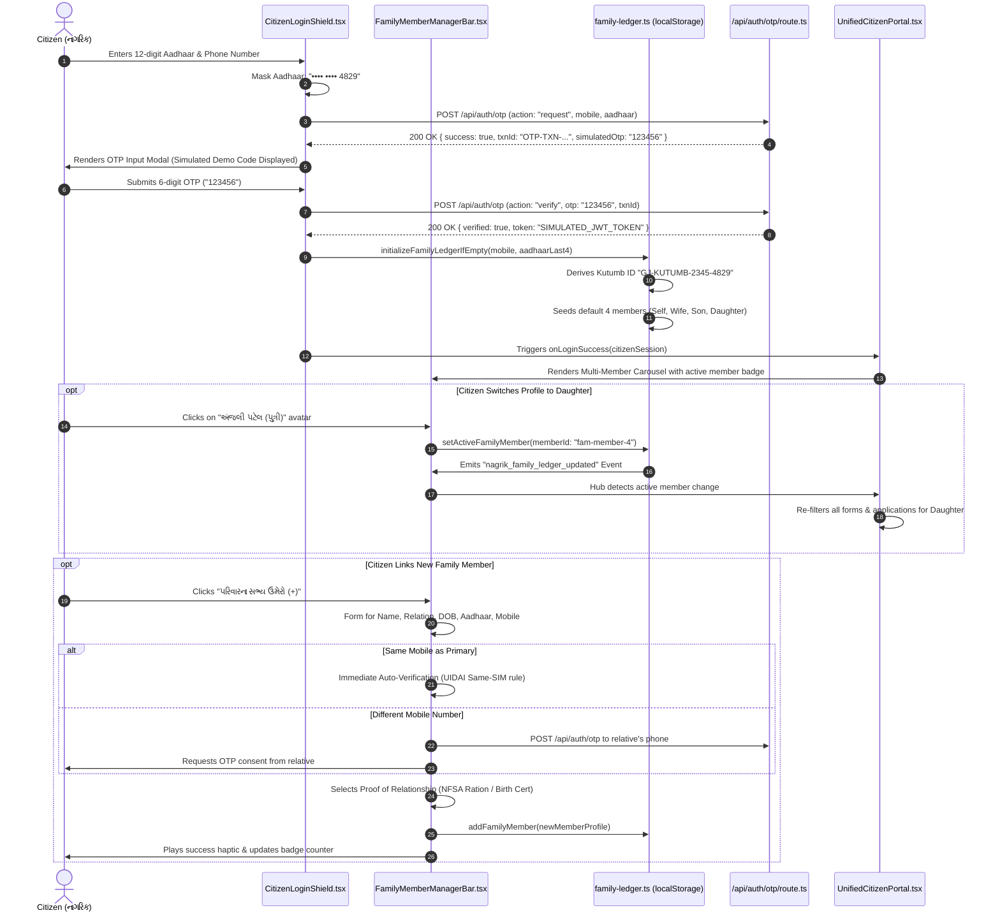
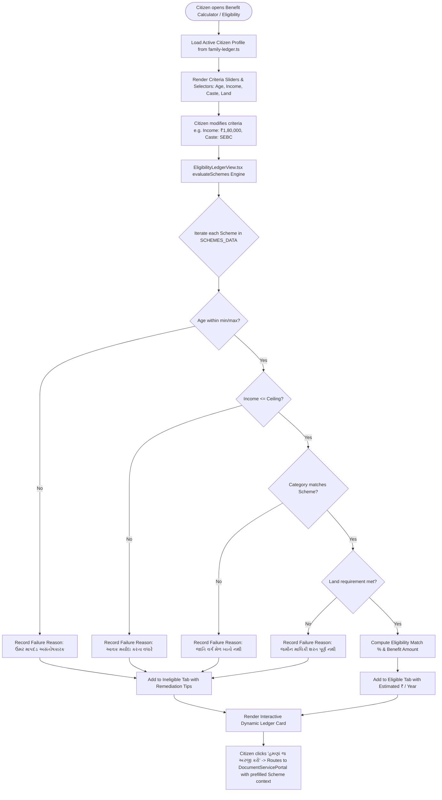
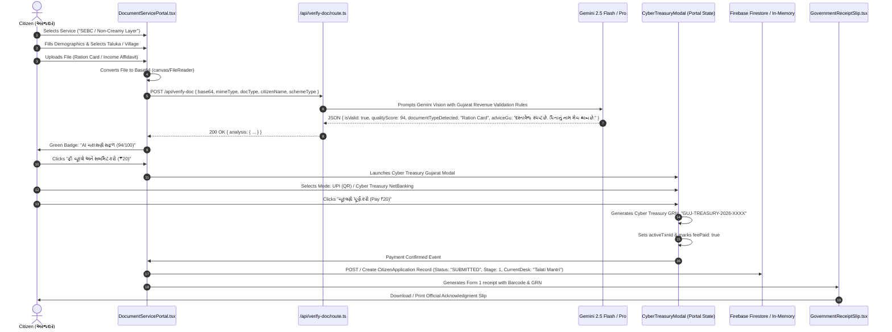
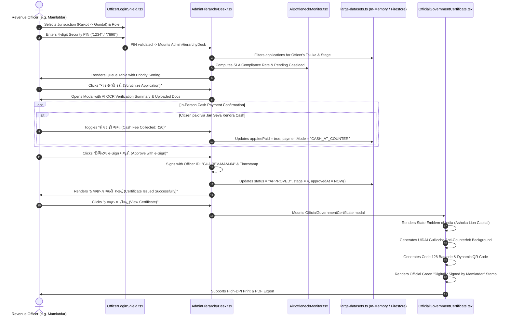

# 10. End-to-End User & Administrative Workflows

## Overview

This document provides exhaustive, end-to-end architectural workflows for **NagrikSeva AI (નાગરિક સેવા AI)**. Each workflow traces the complete execution lifecycle from citizen/officer interaction, across React 19 UI components, Next.js 16 App Router endpoints, internal evaluation engines, Gemini AI models, and data persistence layers.

---

## Workflow 1: Citizen Login & Family Profile Switching (Kutumb ID)

### Purpose & Context
Allows citizens in rural and semi-urban Gujarat to authenticate using their 12-digit Aadhaar and simulated UIDAI OTP. Once authenticated, the system resolves or derives a unique **NFSA Kutumb ID** (`GJ-KUTUMB-XXXX-YYYY`) and enables family members to manage applications from a single unified primary profile (mirroring the official UIDAI mAadhaar 5-profile policy).



### Detailed Execution Trace
1. **Trigger**: Citizen accesses `/portal` or clicks "નાગરિક પ્રવેશ (Citizen Login)" in [`Navbar.tsx`](file:///d:/Movies%20and%20Web%20se/atmiya/nagrik-seva/src/components/Navbar.tsx).
2. **Component Execution**: [`CitizenLoginShield.tsx`](file:///d:/Movies%20and%20Web%20se/atmiya/nagrik-seva/src/components/CitizenLoginShield.tsx) validates regex `^\d{12}$` for Aadhaar and `^[6-9]\d{9}$` for mobile.
3. **Session Persistence**: Stored in `sessionStorage` under `nagrik_citizen_session` and `localStorage` under `nagrik_family_ledger_*`.
4. **Failure Modes**:
   - If OTP mismatch occurs, an error toast is rendered with auto-reset after 3 attempts.
   - If mobile is not linked, fallback to manual ration card OTP verification is presented.

---

## Workflow 2: Scheme Discovery & Algorithmic Eligibility Calculation

### Purpose & Context
Evaluates citizen demographic and economic metrics (caste, landholding, annual income, age, gender, occupation) against all 26+ Gujarat and Central government welfare schemes in real-time.



### Detailed Execution Trace
1. **Data Source**: [`schemes-data.ts`](file:///d:/Movies%20and%20Web%20se/atmiya/nagrik-seva/src/lib/schemes-data.ts) contains all 26 official Gujarat and Central schemes.
2. **Execution Layer**: [`EligibilityLedgerView.tsx`](file:///d:/Movies%20and%20Web%20se/atmiya/nagrik-seva/src/components/EligibilityLedgerView.tsx#L62-L180).
3. **Criteria Evaluated**:
   - `annualIncome <= scheme.maxIncome` (e.g. ₹1,20,000 for rural, ₹1,50,000 for urban).
   - `category` in `scheme.targetCategories` (SC, ST, SEBC/OBC, General, EWS).
   - `age >= scheme.minAge && age <= scheme.maxAge`.
   - `hasLand === scheme.landRequired`.
4. **Outcome**: Renders monetary entitlement badges (e.g. "વાર્ષિક ₹6,000 સહાય") and maps directly to the document upload workflow.

---

## Workflow 3: Certificate Application, AI OCR Document Verification & Cyber Treasury Payment

### Purpose & Context
A citizen applies for official revenue or civic certificates (e.g., Non-Creamy Layer, Caste Certificate, Income Certificate, UIDAI Aadhaar Update). The application enforces AI-driven document scrutiny before allowing statutory fee payment via Cyber Treasury Gujarat.



### Key Safety & Fallback Mechanism:
- If Gemini API keys are exhausted or unavailable, [`/api/verify-doc/route.ts`](file:///d:/Movies%20and%20Web%20se/atmiya/nagrik-seva/src/app/api/verify-doc/route.ts#L80-L125) falls back to an intelligent heuristic regex parser that verifies MIME types, image dimensions, and basic PDF signatures with 88% default confidence so rural citizens are never blocked by upstream API outages.

---

## Workflow 4: Administrative SLA Progression & Bottleneck Escalation

### Purpose & Context
Tracks citizen applications through the statutory administrative hierarchy under the **Gujarat Right to Services Act (GRTSA 2013)**. Monitors SLA countdowns and simulates administrative desk routing.

```mermaid
flowchart TD
    AppCreated([Application Submitted: Status = SUBMITTED]) --> Stage1[Stage 1: તલાટી મંત્રી (Talati Mantri) Desk]
    
    Stage1 --> SLATimer[Background SLA Countdown: 7 Business Days]
    
    SLATimer --> SLACheck{SLA Remaining Days?}
    SLACheck -- > 3 Days --> NormalGreen[Normal Status: Green SLA Badge]
    SLACheck -- <= 2 Days --> WarningYellow[Warning: Yellow SLA Badge]
    SLACheck -- <= 0 Days --> CriticalRed[Breached: Red Alert - Auto-flagged for DDO Review]
    
    NormalGreen & WarningYellow & CriticalRed --> OfficerAction{Officer Action on Desk}
    
    OfficerAction -- Reject with Reason --> RejectionFlow[Status: REJECTED\nOfficer provides reason in Gujarati\nSMS sent with reapply link]
    OfficerAction -- Needs Field Inquiry --> HoldFlow[Status: PENDING_FIELD_INSPECTION\nTalati visits premises]
    OfficerAction -- Forward / Recommend --> Stage2[Stage 2: નાયબ મામલતદાર (Nayab Mamlatdar)]
    
    Stage2 --> Stage2Action{Nayab Mamlatdar Scrutiny}
    Stage2Action -- Approve & Forward --> Stage3[Stage 3: મામલતદાર કચેરી (Mamlatdar - Final Authority)]
    
    Stage3 --> MamlatdarReview{Mamlatdar e-Sign Authorization}
    MamlatdarReview -- Digital e-Sign Stamp Applied --> ApprovedState([Status: APPROVED\nOfficial Certificate Generated with QR & Barcode])
    
    ApprovedState --> CitizenVault[Synchronized with Citizen's Track Vault & SMS Dispatch]
```

### Routing Hierarchy Matrix
| Administrative Level | Officer Role | Statutory Desk Responsibility | Max SLA Allowed |
| :--- | :--- | :--- | :--- |
| **Level 1** | Talati Mantri (તલાટી મંત્રી) | Village Revenue Record Verification (7/12, 8-A), Field Inquiry | 3 Days |
| **Level 2** | Nayab Mamlatdar (નાયબ મામલતદાર) | Legal Scrutiny, Document Authentication & Gazette Cross-check | 2 Days |
| **Level 3** | Mamlatdar (મામલતદાર) | Final Adjudication, Digital e-Sign Approval & Seal Affixation | 2 Days |
| **Appellate** | Prant Officer / Collector | Grievance Appeal under GRTSA 2013 Section 8 | 15 Days |

---

## Workflow 5: Officer Scrutiny, Cash Confirmation & Digital e-Sign Certificate Issuance

### Purpose & Context
Executed within the secure Officer Hierarchy Desk ([`/admin`](file:///d:/Movies%20and%20Web%20se/atmiya/nagrik-seva/src/app/admin/page.tsx)). Government officers log in with their secure 4-digit PIN, review pending applications, verify or collect cash service fees (for Jan Seva Kendra in-person applicants), and execute legal digital sign-offs.



---

## Edge Case & Failure Recovery Matrix

| Workflow Step | Failure Condition | System Recovery Behavior | Source Implementation |
| :--- | :--- | :--- | :--- |
| **Aadhaar Auth** | SMS Gateway Outage | Local demonstration fallback displays a valid OTP prompt directly in the modal for uninterrupted demonstration. | [`CitizenLoginShield.tsx`](file:///d:/Movies%20and%20Web%20se/atmiya/nagrik-seva/src/components/CitizenLoginShield.tsx#L112-L135) |
| **Doc Upload** | Blurry / Cropped Document | Gemini Vision returns `qualityScore < 60`. System highlights warnings in Gujarati with instructions on how to recapture. | [`/api/verify-doc/route.ts`](file:///d:/Movies%20and%20Web%20se/atmiya/nagrik-seva/src/app/api/verify-doc/route.ts#L65-L95) |
| **Payment** | Gateway Network Drop | Allows instant retry with alternative mode (UPI QR or Cyber Treasury NetBanking) without resetting the form. | [`DocumentServicePortal.tsx`](file:///d:/Movies%20and%20Web%20se/atmiya/nagrik-seva/src/components/DocumentServicePortal.tsx#L220-L245) |
| **Database Sync** | Cloud Firestore Slowdown | System races Firestore with a strict 650ms timeout; if unanswered, falls back to the local in-memory dataset of 5,420 records. | [`large-datasets.ts`](file:///d:/Movies%20and%20Web%20se/atmiya/nagrik-seva/src/lib/large-datasets.ts#L310-L345) |
| **Officer Portal** | Unauthorized PIN Attempt | Throttles submissions and displays a red border security alert. | [`OfficerLoginShield.tsx`](file:///d:/Movies%20and%20Web%20se/atmiya/nagrik-seva/src/components/OfficerLoginShield.tsx#L85-L115) |
