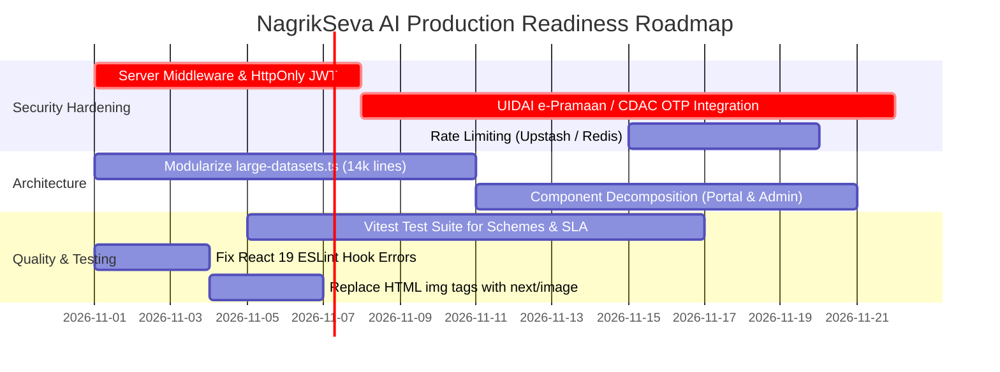

# 12. Architectural Risks, Security Gaps & Technical Debt

## Overview

This audit document identifies, categorizes, and prioritizes all technical risks, security vulnerabilities, missing production safeguards, and architectural gaps discovered during the deep codebase inspection of **NagrikSeva AI (નાગરિક સેવા AI)**.

---

## Risk Severity Matrix

| Risk ID | Title | Category | Severity | Business Impact | Remediation Effort |
| :--- | :--- | :--- | :--- | :--- | :--- |
| **SEC-01** | Simulated Citizen OTP & Fixed Officer PINs | Authentication | 🔴 **CRITICAL** | Unauthorized access if deployed without UIDAI gateway | Moderate |
| **SEC-02** | Missing Server Middleware Guard for Admin Desk | Authorization | 🔴 **CRITICAL** | `/admin` accessible directly via HTTP without server JWT | Low |
| **DATA-01** | Ephemeral In-Memory Fallback State | Data Persistence| 🔴 **CRITICAL** | Data loss across server restarts if Firestore is offline | Moderate |
| **REL-01** | Total Absence of Automated Test Harness | Code Quality | 🟠 **HIGH** | High regression risk during scheme/rule updates | High |
| **ARCH-01** | Monolithic File Sizes (`large-datasets.ts` 14k+ lines) | Maintainability | 🟠 **HIGH** | Extreme cognitive load, slow IDE parsing, high bundle size | High |
| **AI-01** | No Server-Side Rate Limiting on Gemini Endpoints | Cost & DOS | 🟠 **HIGH** | API quota exhaustion & unbounded billing exposure | Low |
| **SEC-03** | Cleartext Citizen Demographics in `localStorage` | Privacy / GDPR | 🟡 **MEDIUM** | XSS vulnerability could expose citizen profiles | Low |
| **UI-01** | React 19 Concurrent Rendering Violations | Performance | 🟡 **MEDIUM** | Cascading re-renders & impure render calls in effects | Low |
| **PERF-01** | Unoptimized Native `` Tags | Performance | 🟢 **LOW** | Suboptimal Largest Contentful Paint (LCP) on 3G | Low |
| **INT-01** | Simulated Cyber Treasury Gujarat Payment Gateway | Integration | 🟢 **LOW** | Mock GRN generation rather than live SBI ePay gateway | Moderate |

---

## Detailed Risk Analysis & Evidence

### 1. SEC-01: Simulated Citizen OTP & Fixed Officer PINs (🔴 Critical)
- **Vulnerability**:
  - In [`/api/auth/otp/route.ts`](file:///d:/Movies%20and%20Web%20se/atmiya/nagrik-seva/src/app/api/auth/otp/route.ts#L45-L65), the OTP endpoint returns a hardcoded demo OTP (`123456`) and verifies any input matching `123456`.
  - In [`admin-hierarchy-data.ts`](file:///d:/Movies%20and%20Web%20se/atmiya/nagrik-seva/src/lib/admin-hierarchy-data.ts#L18-L45), officer accounts have hardcoded 4-digit PINs (`1234`, `7890`, `4567`) stored directly in client-side static TypeScript arrays.
- **Evidence**:
  ```typescript
  // src/lib/admin-hierarchy-data.ts
  export const HIERARCHICAL_OFFICERS: OfficerNode[] = [
    {
      id: "GUJ-REV-001",
      name: "આર. કે. જાડેજા",
      designation: "તલાટી મંત્રી (Talati Mantri)",
      pin: "1234", // Plaintext client-side PIN
  ```
- **Remediation**:
  1. Citizen Login: Integrate government CDAC / NIC e-Pramaan Single Sign-On or official UIDAI Aadhaar OTP Auth API via licensed AUA/KUA.
  2. Officer Login: Implement OAuth2 / OpenID Connect integrated with Gujarat State Data Centre (GSDC) LDAP/Active Directory with Hardware Security Key (FIDO2) or e-Sign dongle.

---

### 2. SEC-02: Missing Server Middleware Guard for Admin Desk (🔴 Critical)
- **Vulnerability**:
  - The application lacks a Next.js root `middleware.ts`.
  - Access control to [`/admin`](file:///d:/Movies%20and%20Web%20se/atmiya/nagrik-seva/src/app/admin/page.tsx) is enforced purely inside React state via [`OfficerLoginShield.tsx`](file:///d:/Movies%20and%20Web%20se/atmiya/nagrik-seva/src/components/OfficerLoginShield.tsx).
- **Impact**: While the page conditionally renders the UI based on state, any client can inspect component bundles or call underlying API endpoints directly without passing server-side cryptographic verification.
- **Remediation**:
  1. Add Next.js `middleware.ts` verifying an `HttpOnly`, `SameSite=Strict`, `Secure` JWT session cookie.
  2. Protect all `/api/applications/*` mutations with officer role claim validations on the server.

---

### 3. DATA-01: Ephemeral In-Memory Fallback State (🔴 Critical)
- **Vulnerability**:
  - The system utilizes a dual-engine persistence model. When Firebase environment variables are omitted or during a 650ms timeout, operations execute against `APPLICATION_DATABASE` in [`large-datasets.ts`](file:///d:/Movies%20and%20Web%20se/atmiya/nagrik-seva/src/lib/large-datasets.ts#L295-L330).
  - In Next.js serverless runtimes (such as Vercel Lambdas), in-memory variables are destroyed when worker instances scale down or recycle.
- **Impact**: Applications submitted or approved in one session will disappear if the serverless container is recycled before being persisted to an external database.
- **Remediation**:
  Ensure Cloud Firestore or PostgreSQL / CockroachDB is configured as a mandatory connection in production with connection health checks during server startup.

---

### 4. REL-01: Total Absence of Automated Test Harness (🟠 High)
- **Vulnerability**:
  - The codebase contains **0 unit tests**, **0 integration tests**, and **0 automated component tests**.
  - `package.json` contains no test runner script (`jest`, `vitest`, `playwright test`).
- **Impact**:
  The core business logic spans over 26 schemes with complex nested eligibility matrices (income limits, land thresholds, age brackets, caste reservations). Any manual modification to [`schemes-data.ts`](file:///d:/Movies%20and%20Web%20se/atmiya/nagrik-seva/src/lib/schemes-data.ts) or [`EligibilityLedgerView.tsx`](file:///d:/Movies%20and%20Web%20se/atmiya/nagrik-seva/src/components/EligibilityLedgerView.tsx) risks silent calculation errors for citizens without automated regression safety.
- **Remediation**:
  1. Install `vitest` and `@testing-library/react`.
  2. Implement unit test suites verifying all 26 schemes against positive and negative edge case citizen profiles.

---

### 5. ARCH-01: Monolithic File Sizes (🟠 High)
- **Vulnerability**:
  - [`src/lib/large-datasets.ts`](file:///d:/Movies%20and%20Web%20se/atmiya/nagrik-seva/src/lib/large-datasets.ts) contains **14,359 lines** (5,420 mock applications, 33 districts, 248 talukas, 18,000+ villages, and service definitions).
  - [`src/components/DocumentServicePortal.tsx`](file:///d:/Movies%20and%20Web%20se/atmiya/nagrik-seva/src/components/DocumentServicePortal.tsx) contains **3,025 lines**.
  - [`src/components/AdminHierarchyDesk.tsx`](file:///d:/Movies%20and%20Web%20se/atmiya/nagrik-seva/src/components/AdminHierarchyDesk.tsx) contains **2,077 lines**.
- **Impact**:
  Extremely high maintenance complexity, slow TypeScript compiler language service evaluation in IDEs, and risk of accidental merge conflicts during team collaboration.
- **Remediation**:
  1. Extract district/taluka/village datasets into JSON fixtures or static database seeders.
  2. Modularize `DocumentServicePortal.tsx` into discrete sub-components (`DocumentUploadCard.tsx`, `ApplicantDemographicForm.tsx`, `CyberTreasuryModal.tsx`).

---

### 6. AI-01: Absence of Server-Side Rate Limiting on Gemini Endpoints (🟠 High)
- **Vulnerability**:
  - [`/api/chat`](file:///d:/Movies%20and%20Web%20se/atmiya/nagrik-seva/src/app/api/chat/route.ts) and [`/api/verify-doc`](file:///d:/Movies%20and%20Web%20se/atmiya/nagrik-seva/src/app/api/verify-doc/route.ts) accept arbitrary incoming requests without IP or token rate-limiting.
- **Impact**: An attacker or scripted loop could flood the document verification endpoint with base64 payloads, exhausting the Google Gemini API monthly quota or incurring steep API charges.
- **Remediation**:
  Implement an Upstash Redis or memory-cache token bucket rate limiter (e.g. max 5 document scans per citizen IP/minute).

---

### 7. SEC-03: Cleartext Citizen Demographics in `localStorage` (🟡 Medium)
- **Vulnerability**:
  - Citizen session data (`nagrik_citizen_session`) and family ledger records (`nagrik_family_ledger_*`) are written directly to unencrypted browser storage.
- **Impact**: Any cross-site scripting (XSS) vulnerability or browser extension could read family names, ages, relationships, and masked Aadhaar numbers.
- **Remediation**:
  Store session state strictly in server-managed session cookies or encrypt client storage using Web Crypto API (`AES-GCM`).

---

### 8. UI-01: React 19 Concurrent Rendering Lint Violations (🟡 Medium)
- **Vulnerability**:
  - 5 ESLint errors under React 19 rules: `react-hooks/set-state-in-effect` in [`ChatBot.tsx`](file:///d:/Movies%20and%20Web%20se/atmiya/nagrik-seva/src/components/ChatBot.tsx) and [`FamilyMemberManagerBar.tsx`](file:///d:/Movies%20and%20Web%20se/atmiya/nagrik-seva/src/components/FamilyMemberManagerBar.tsx), and impure `Math.random` call during render.
- **Impact**: May cause hydration mismatches, layout jumps, or extra render passes in production React 19 concurrent mode.
- **Remediation**:
  Refactor state synchronization out of `useEffect` body into event handlers, and use `crypto.getRandomValues` outside of render cycles.

---

## Technical Debt Remediation Roadmap


