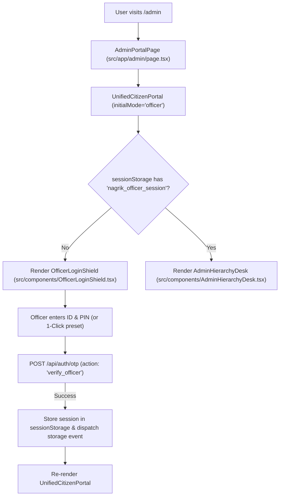

# NagrikSeva AI — Admin & Officer Side Deep Investigation
## Document 01: Navigation Architecture & Complete Route Map

> **Audit Date:** October 2026  
> **Target Scope:** Admin routes, URL parameters, component hierarchy, session gates, and navigation trees.  
> **Source Files Audited:** `src/app/admin/page.tsx`, `src/components/UnifiedCitizenPortal.tsx`, `src/components/OfficerLoginShield.tsx`, `src/components/AdminHierarchyDesk.tsx`.  

---

### 1. Administrative Route Structure

NagrikSeva AI uses Next.js 15 App Router. The administrative desk is accessed through dedicated paths as well as contextual portal modes:

| Route Path | Query Parameters | Component Rendered | Access Control Gate | Purpose |
| :--- | :--- | :--- | :--- | :--- |
| `/admin` | None | `AdminPortalPage` $\rightarrow$ `UnifiedCitizenPortal(initialMode="officer", initialTab="track")` | Checks `sessionStorage.getItem("nagrik_officer_session")` | Dedicated administrative entry point |
| `/` or `/track` | `?mode=officer` or `?mode=admin` | `UnifiedCitizenPortal(initialMode="citizen")` $\rightarrow$ sets `authMode="officer"` via `useEffect` | Checks `sessionStorage.getItem("nagrik_officer_session")` | Direct link from notifications or administrative bookmarks |
| `/track` | None | `UnifiedCitizenPortal(initialMode="citizen")` | Defaults to Citizen mode; allows segmented switch to Officer | Citizen tracking vault with administrative toggle |



---

### 2. Officer Dashboard Screen & Component Hierarchy

Once authenticated, `AdminHierarchyDesk` renders a single-page reactive dashboard with three primary operational tabs and four modal overlays:

```
UnifiedCitizenPortal (src/components/UnifiedCitizenPortal.tsx)
 └── AdminHierarchyDesk (src/components/AdminHierarchyDesk.tsx)
      ├── Officer Identity Header (Lines 811–873)
      │    ├── Avatar, Name, Designation & Office ID
      │    ├── Jurisdiction Badge ("અધિકારક્ષેત્ર: ગોંડલ તાલુકો")
      │    ├── Duty Status Pill ("ફરજ પર" vs "રજા પર")
      │    ├── Leave Protocol Toggle ("રજા નોંધાવો")
      │    └── Officer Logout Button ("લૉગઆઉટ")
      │
      ├── Supervisor Inspection Alert Banner (Lines 876–894)
      │    └── Visible only when higher authority inspects subordinate desk
      │
      ├── Administrative Clearance Switcher Bar (Lines 897–947)
      │    └── Horizontal button strip constrained by authenticated officer rank
      │
      ├── Navigation Tabs Strip (Lines 970–1016)
      │    ├── Tab 1: અરજી સ્ક્રુટિની (Application Queue & Scrutiny)
      │    ├── Tab 2: AI બોટલનેક (AI SLA Bottleneck Monitor)
      │    └── Tab 3: પોલિસી CMS (Policy CMS — Super Admin only)
      │
      ├── Tab 1 View: Queue & Scrutiny
      │    ├── Cascading Filter Bar (Lines 1024–1181)
      │    │    ├── District Dropdown (Locked for Tiers 2–5)
      │    │    ├── Taluka Dropdown (Dynamic based on jurisdiction)
      │    │    ├── Village / City Dropdown (Dynamic based on taluka)
      │    │    ├── Status Filter Dropdown
      │    │    ├── Search Input (App ID, citizen name, village)
      │    │    └── 1-Hour SLA Breached Toggle Pill
      │    │
      │    ├── Desktop Table View (Lines 1197–1352)
      │    │    ├── Col 1: અરજી ક્રમાંક & નાગરિક (ID, Citizen Name, UID, Village)
      │    │    ├── Col 2: સેવા & કચેરી (Scheme Name, Location)
      │    │    ├── Col 3: ચુકવણી & રસીદ (Payment status, View Receipt Slip)
      │    │    ├── Col 4: ૧-કલાક SLA (Elapsed minutes, Current Desk)
      │    │    ├── Col 5: તબક્કો (Stage 1 Scrutiny / Stage 3 Approved)
      │    │    └── Col 6: કાર્યવાહી ("ફાઇલ ખોલો" Action Button)
      │    │
      │    └── Mobile Card Stack View (Lines 1354–1480)
      │         └── Touch-optimized native card list with 44px minimum tap targets
      │
      ├── Tab 2 View: AI Bottleneck Monitor (Lines 1488–1500)
      │    └── AiBottleneckMonitor (src/components/AiBottleneckMonitor.tsx)
      │
      ├── Tab 3 View: Dynamic Policy CMS (Lines 1505–1646)
      │    └── Service Policy Form (Fee, SLA Days, Alert Minutes, Checklist)
      │
      └── Administrative Modal Overlays
           ├── 1. Application Review Modal (Lines 1651–1993)
           │    ├── Applicant Profile Card (Name, UID, Location, Date)
           │    ├── 1-Hour SLA Status Alert
           │    ├── AI Vision OCR Inspector (3 document previews)
           │    ├── Action Gate 1: Payment Verification
           │    ├── Action Gate 2: Mamlatdar Digital e-Sign
           │    └── AI Local Gujarati Rejection Translator Cockpit
           │
           ├── 2. Document Zoom Lightbox Modal (Lines 1996–2037)
           │    └── Fullscreen image preview with structured OCR key-value readout
           │
           ├── 3. Official Certificate Preview Modal (Lines 2042–2055)
           │    └── OfficialGovernmentCertificate (src/components/OfficialGovernmentCertificate.tsx)
           │
           └── 4. Official Receipt Slip Modal (Lines 2060–2073)
                └── GovernmentReceiptSlip (src/components/GovernmentReceiptSlip.tsx)
```

---

### 3. Route Guards & Session Synchronization

#### A. Session Storage Keys
1. `nagrik_officer_session`: Holds the active `OfficerProfile` object currently in context.
2. `nagrik_authenticated_officer`: Holds the original officer who authenticated at the login screen. Used as an **immutable clearance anchor** so an inspecting officer cannot exceed their authorized rank.

#### B. Storage Event Listener
`UnifiedCitizenPortal` registers a global `window.addEventListener("storage", syncSession)` listener (Lines 38–92). Any session change in one tab updates the portal state across all open windows.

#### C. Logout Execution
`handleOfficerLogout` in `UnifiedCitizenPortal.tsx` (Lines 122–128):
```typescript
const handleOfficerLogout = () => {
  sessionStorage.removeItem("nagrik_officer_session");
  sessionStorage.removeItem("nagrik_authenticated_officer");
  window.dispatchEvent(new Event("storage"));
  setOfficerSession(null);
  setAuthMode("citizen");
};
```
Clearing both keys resets the UI to citizen mode and ensures no residual clearance remains in session memory.
