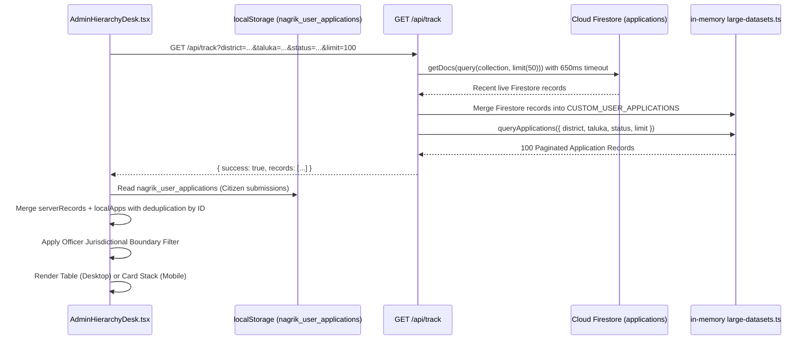

# NagrikSeva AI — Admin & Officer Side Deep Investigation
## Document 03: Application List & Application Detail Workflow

> **Audit Date:** October 2026  
> **Target Scope:** Application Queue Retrieval, Cascading Filters, In-Memory & Firestore Sync, Local Storage Merging, Table & Mobile Card Layouts, Document Scrutiny Modal, and OCR Zoom Lightbox.  
> **Source Files Audited:** `src/components/AdminHierarchyDesk.tsx`, `src/app/api/track/route.ts`, `src/lib/large-datasets.ts`, `src/components/Skeleton.tsx`.  

---

### 1. Application Queue Population & Data Retrieval Flow

The application queue is populated by a unified client-server-local pipeline:



#### A. Client-Side Merge & Deduplication
In [`AdminHierarchyDesk.tsx`](file:///d:/Movies%20and%20Web%20se/atmiya/nagrik-seva/src/components/AdminHierarchyDesk.tsx#L476-L500):
```typescript
let serverRecords: CitizenApplication[] = data.records;

if (typeof window !== "undefined") {
  try {
    const raw = localStorage.getItem("nagrik_user_applications");
    if (raw) {
      const localApps: CitizenApplication[] = JSON.parse(raw);
      serverRecords = [...localApps, ...serverRecords];
    }
  } catch (e) {
    console.warn("Admin local storage parse error:", e);
  }
}

const seen = new Set<string>();
const unique: CitizenApplication[] = [];
for (const item of serverRecords) {
  if (item && item.id && !seen.has(item.id)) {
    seen.add(item.id);
    unique.push(item);
  }
}
setApplications(unique);
```
This ensures that applications newly submitted by a citizen in another browser tab appear **immediately** in the officer's pending queue without requiring a database round-trip.

---

### 2. Cascading Jurisdictional Filters

The filter bar (Lines 1024–1181) dynamically cascades based on the logged-in officer's jurisdiction:

```
[District Dropdown] ──────► [Taluka Dropdown] ──────► [Village Dropdown]
(All 33 vs Locked)         (Filtered by District)     (Filtered by Taluka)
```

1. **District Dropdown:**
   - Active only for `state_admin` (`GUJ-STATE-001`).
   - Locked with 🔒 badge for Collector, SDM, Mamlatdar, and Talati to their respective assigned district (`Rajkot`).
2. **Taluka Dropdown:**
   - Active for `state_admin` (all 248 talukas), Collector (11 talukas of Rajkot), and SDM (3 talukas of Gondal Sub-division).
   - Locked to `Gondal` for Mamlatdar and Talati.
3. **Village Dropdown:**
   - Dynamically generated using `getVillagesForTaluka(effectiveTaluka)` from `large-datasets.ts`.
   - Locked to `ગોમટા (Gomta)` for Talati Mantri.
4. **1-Hour SLA Filter Pill:**
   - Toggles `slaFilterOnly`. Evaluates `analyzeApplicationSla(app).isBreached` and isolates overdue applications in 1 click.

---

### 3. Queue Presentation: Desktop Table vs. Mobile Cards

To support field officers using smartphones or tablets in village panchayats:

#### A. Desktop Table View (`hidden md:block`, Lines 1197–1352)
- Table-fixed column widths:
  - Col 1 (`20%`): App ID (`APP-GUJ-XXXX`), Citizen Name, Masked Aadhaar (`XXXX-1413`), Village badge.
  - Col 2 (`23%`): Scheme Name (`આવકનું પ્રમાણપત્ર`), Office Location badge.
  - Col 3 (`17%`): Payment Status badge (`ચુકવણી પ્રમાણિત` vs `ચલણ ભરપાઈ બાકી`), "સરકારી પાવતી જુઓ" link.
  - Col 4 (`18%`): 1-Hour SLA badge (`XX મિ. પેન્ડિંગ`), current desk designation.
  - Col 5 (`12%`): Workflow stage badge (`તબક્કો ૧: સ્ક્રુટિની` vs `e-Signed (મંજૂર)`).
  - Col 6 (`10%`): "ફાઇલ ખોલો" action button.
- Max height capped at `580px` with vertical scroll to prevent whole-page stretching.

#### B. Mobile Card Stack View (`md:hidden`, Lines 1354–1480)
- Touch-friendly vertical card list (`touch-pan-y`).
- Minimum tap targets of `44px` for touch ergonomics.
- Shows citizen name, scheme, village, payment pill, and action buttons (`પ્રમાણપત્ર`, `પાવતી`, `ફાઇલ સ્ક્રુટિની ખોલો`).

---

### 4. Application Review & Scrutiny Modal

When the officer clicks **"ફાઇલ ખોલો"**, `reviewModalOpen` becomes `true` (Lines 1651–1993):

```
┌─────────────────────────────────────────────────────────────────────────────┐
│ અરજી વિગત & અધિકારી સ્ક્રુટિની ડેસ્ક • APP-GUJ-5829                [ X ]  │
├─────────────────────────────────────────────────────────────────────────────┤
│ 👤 અરજદાર: હરી વિનોદરાઈ પટેલ       │ 🪪 નાગરિક ID: GUJ-CIT-1413             │
│ 📍 સ્થળ: મુ. ગોમટા, તા. ગોંડલ        │ 📅 અરજી તારીખ: 2026-09-28               │
├─────────────────────────────────────────────────────────────────────────────┤
│ ⏱️ ૧-કલાક SLA સ્થિતિ: ૪૮ મિનિટ પેન્ડિંગ — પ્રાથમિક તલાટી સ્ક્રુટિની હેઠળ     │
├─────────────────────────────────────────────────────────────────────────────┤
│ 📋 અપલોડ કરેલા અસલ દસ્તાવેજો (AI Vision OCR ઇન્સ્પેક્ટર)                    │
│                                                                             │
│ ┌──────────────────────┐ ┌──────────────────────┐ ┌──────────────────────┐  │
│ │ [PAN / Aadhaar Img]  │ │ [PGVCL Bill Img]     │ │ [Birth Cert Img]     │  │
│ │ ૧. ઓળખ પુરાવો        │ │ ૨. રહેઠાણ પુરાવો     │ │ ૩. જન્મ/આવક પુરાવો   │  │
│ │ [AI માન્ય: 98%]       │ │ [AI માન્ય: 95%]       │ │ [AI માન્ય: 94%]       │  │
│ │ [🔍 ઝૂમ કરો]          │ │ [🔍 ઝૂમ કરો]          │ │ [🔍 ઝૂમ કરો]          │  │
│ └──────────────────────┘ └──────────────────────┘ └──────────────────────┘  │
├─────────────────────────────────────────────────────────────────────────────┤
│ ⚖️ સત્તાવાર અધિકારી કાર્યવાહી (Action Gates)                                 │
│                                                                             │
│ [ Gate 1: ચુકવણી ખરાઈ ]          │ [ Gate 2: ડિજિટલ e-Sign & પ્રમાણપત્ર ]   │
│ ✅ ફી પ્રમાણિત (Txn: 8921)         │ 🖋️ ડિજિટલ સહી (e-Sign) મંજૂર કરો         │
├─────────────────────────────────────────────────────────────────────────────┤
│ ✨ AI સ્થાનિક ગુજરાતી ભાષાંતરકાર (સુધારણા / રિજેક્શન નોંધ)                  │
│ [ Input technical reason in English / Guj...                       ]        │
│ [ ⚡ AI ગુજરાતીમાં રૂપાંતર કરો ] ──► [ Preview Courteous Notice ]             │
└─────────────────────────────────────────────────────────────────────────────┘
```

#### Document Zoom Lightbox Modal (Lines 1996–2037)
Clicking **"ઝૂમ કરો"** opens an inspection lightbox with structured OCR key-value pairs:
- **PAN / Aadhaar:** Name, Masked UID, AI OCR Score (`98.4% Match`), Verification Status.
- **PGVCL Bill:** Consumer Number (`PGVCL-8921-0421`), Address, Bill Date, Match Status (`૧૦૦% મેળ`).
- **Birth / Income Proof:** Certificate Number, Talati Round Seal Verification (`સત્તાવાર રાઉન્ડ સીલ માન્ય`), AI Confidence.
