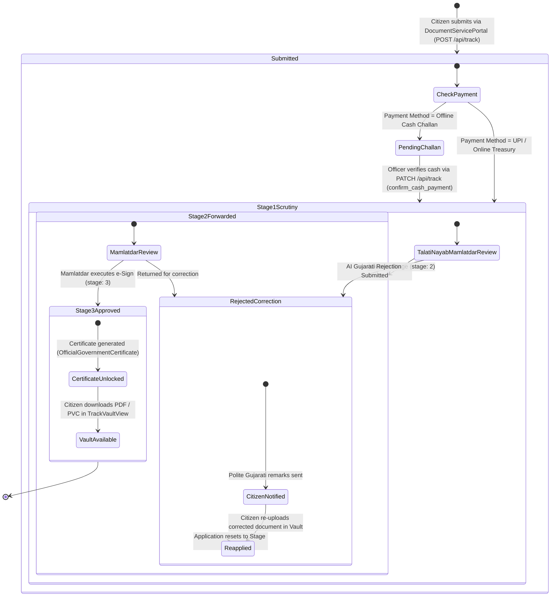

# NagrikSeva AI — Admin & Officer Side Deep Investigation
## Document 04: Application Lifecycle & State Transitions

> **Audit Date:** October 2026  
> **Target Scope:** State Machine, Workflow Stages (1 to 3), Stage Advancement, Rejection Handling, Offline Payment Release, and Citizen Vault Synchronization.  
> **Source Files Audited:** `src/lib/large-datasets.ts`, `src/app/api/track/route.ts`, `src/components/AdminHierarchyDesk.tsx`, `src/components/TrackVaultView.tsx`.  

---

### 1. Complete Workflow State Machine

The application lifecycle follows a strict state transition model governed by administrative gates:



---

### 2. State & Field Mutations at Each Transition

| Workflow State | `status` Field | `workflowStage` | `officerDesignation` | `paymentStatus` | Visible Citizen Effect |
| :--- | :--- | :---: | :--- | :--- | :--- |
| **Initial Online** | `"processing"` | `1` | નાયબ મામલતદાર (સ્ક્રુટિની શાખા) | `"paid"` | Application active; Stage 1 blue pill |
| **Initial Cash Challan** | `"processing"` | `1` | નાયબ મામલતદાર (સ્ક્રુટિની શાખા) | `"pending_challan"` | Certificate locked; "ચલણ જમા કરાવો" alert |
| **Cash Confirmed** | `"processing"` | `1` | નાયબ મામલતદાર (સ્ક્રુટિની શાખા) | `"paid"` | Payment confirmed pill; receipt download unlocked |
| **Forwarded (Stage 2)** | `"processing"` | `2` | તાલુકા મામલતદાર & એક્ઝિક્યુટિવ મેજિસ્ટ્રેટ | `"paid"` | Stage 2 progress; Mamlatdar desk banner |
| **Approved (Stage 3)** | `"approved"` | `3` | તાલુકા મામલતદાર & એક્ઝિક્યુટિવ મેજિસ્ટ્રેટ | `"paid"` | "e-Signed મંજૂર"; Certificate download unlocked |
| **Rejected / Clarification**| `"rejected"` | `2` | Reviewing Officer | Unchanged | Rose alert with polite Gujarati instructions & re-upload |

---

### 3. Transition Logic in Source Code

#### A. Offline Cash Payment Release (`confirm_cash_payment`)
Executed in [`src/app/api/track/route.ts`](file:///d:/Movies%20and%20Web%20se/atmiya/nagrik-seva/src/app/api/track/route.ts#L362-L393) calling `confirmApplicationPayment(id)` in [`src/lib/large-datasets.ts`](file:///d:/Movies%20and%20Web%20se/atmiya/nagrik-seva/src/lib/large-datasets.ts#L4620-L4644):
```typescript
export function confirmApplicationPayment(id: string): CitizenApplication | null {
  const cleanId = id.toUpperCase();
  const app = findApplication(cleanId);
  if (!app) return null;

  app.paymentStatus = "paid";
  app.operatorConfirmed = true;
  app.lastUpdated = new Date().toISOString().split("T")[0];
  app.remarksGu = `જન સેવા કેન્દ્ર રોકડ કાઉન્ટર પર ચલણ ફી ₹${app.feeAmount || 50} સ્વીકારાઈ છે. દસ્તાવેજ ચકાસણી આગળ વધી રહી છે.`;
  app.remarksEn = `Cash payment fee ₹${app.feeAmount || 50} confirmed by Jan Seva Kendra operator. Document processing resumed.`;
  return app;
}
```
**Side Effect:** Updates Firestore document with `{ merge: true }` and returns updated record to client.

#### B. Workflow Stage Advancement (`advance_stage`)
Executed in [`src/app/api/track/route.ts`](file:///d:/Movies%20and%20Web%20se/atmiya/nagrik-seva/src/app/api/track/route.ts#L396-L441) calling `advanceWorkflowStage(id, stage, officerRole)` in [`src/lib/large-datasets.ts`](file:///d:/Movies%20and%20Web%20se/atmiya/nagrik-seva/src/lib/large-datasets.ts#L4646-L4694):
```typescript
export function advanceWorkflowStage(
  id: string,
  targetStage: 1 | 2 | 3 | 4,
  officerRole?: string
): CitizenApplication | null {
  const app = findApplication(id);
  if (!app) return null;

  app.workflowStage = targetStage;
  app.lastUpdated = new Date().toISOString().split("T")[0];
  if (officerRole) app.officerDesignation = officerRole;

  if (targetStage === 1) {
    app.status = "processing";
    app.remarksGu = `અરજદાર દ્વારા ઓનલાઇન અરજી સફળતાપૂર્વક સબમિટ થયેલ છે. કચેરી સ્ક્રુટિની ડેસ્ક પર દસ્તાવેજો અને આધાર કાર્ડ ખરાઈની પ્રક્રિયા ચાલુ છે.`;
  } else if (targetStage === 2) {
    app.status = "processing";
    app.remarksGu = `નાયબ મામલતદાર દ્વારા તમામ દસ્તાવેજો (આધાર, આવક, રેશનકાર્ડ પુરાવા) યોગ્ય ચકાસાયેલ છે. તાલુકા મામલતદાર સાહેબની આખરી ડિજિટલ સહી (e-Sign) અર્થે અગ્રેસિત કરેલ છે.`;
  } else if (targetStage === 3 || targetStage === 4) {
    app.status = "approved";
    app.remarksGu = `મામલતદાર કચેરી ${app.taluka} દ્વારા તમામ ચકાસણી પૂર્ણ કરી ડિજિટલ હસ્તાક્ષર (e-Sign) સાથે અરજી મંજૂર કરવામાં આવેલ છે. સત્તાવાર પ્રમાણપત્ર / સહાય માન્ય ઠરેલ છે.`;
  }

  return app;
}
```

---

### 4. Real-Time Citizen Vault Synchronization

When the officer executes an approval (`handleApproveEsign` in `AdminHierarchyDesk.tsx`, Lines 612–675), the following client events trigger:
1. `PATCH /api/track` returns updated application.
2. Updates `nagrik_user_applications` in `localStorage`.
3. Updates `nagrik_citizen_session.activeApplications` in `localStorage`.
4. Dispatches `window.dispatchEvent(new Event("storage"))`.
5. Automatically opens `OfficialGovernmentCertificate` modal for instantaneous printing.

If the citizen has the tracking tab open in another window, the storage event fires, re-renders `TrackVaultView.tsx`, changes the status pill from blue "સ્ક્રુટિની હેઠળ" to green "e-Signed મંજૂર", and activates the **"સત્તાવાર પ્રમાણપત્ર ડાઉનલોડ"** button.
