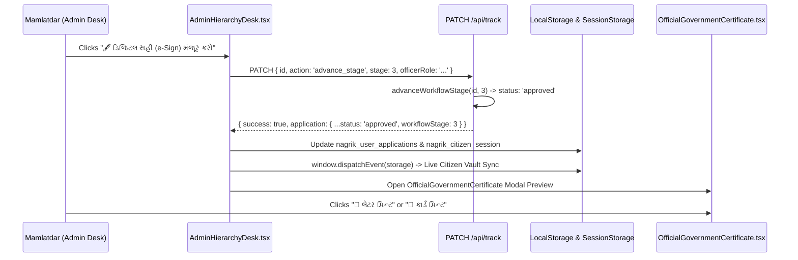

# NagrikSeva AI — Admin & Officer Side Deep Investigation
## Document 05: e-Sign Approval & Official Certificate Issuance

> **Audit Date:** October 2026  
> **Target Scope:** Digital Signature Execution, Certificate Layouts, Printable Engine (Letter vs PVC), Verification QR Codes, and Indian IT Act 2000 Compliance Assessment.  
> **Source Files Audited:** `src/components/OfficialGovernmentCertificate.tsx`, `src/components/AdminHierarchyDesk.tsx`, `src/app/api/track/route.ts`.  

---

### 1. e-Sign Execution Workflow

The administrative e-Sign action is triggered directly within the Application Review Modal in [`AdminHierarchyDesk.tsx`](file:///d:/Movies%20and%20Web%20se/atmiya/nagrik-seva/src/components/AdminHierarchyDesk.tsx#L612-L675):



---

### 2. Certificate Types & Design Artifacts

[`src/components/OfficialGovernmentCertificate.tsx`](file:///d:/Movies%20and%20Web%20se/atmiya/nagrik-seva/src/components/OfficialGovernmentCertificate.tsx) renders four distinct types of authentic government certificates based on the application scheme:

#### Type 1: UIDAI Official e-Aadhaar Document (Lines 345–474)
- **Letter View:**
  - Official Ashoka Pillar Emblem and UIDAI Sun vector logos.
  - Saffron and Green bilingual government banners.
  - Enrolment number, barcode strip, high-density verification QR code.
  - 12-digit formatted Aadhaar number (`5429 8912 XXXX`).
  - Dotted scissors perforation cut line (`✂️ કટઆઉટ કાર્ડ ✂️`).
  - Bottom dual wallet card cutout (Front + Back).
- **PVC Dual-Page View:**
  - Front: Metallic Gold Security Hologram sticker, UIDAI Guilloche security layer, tricolor ribbon, ghost photo watermark.
  - Back: Full Gujarati and English address block, UIDAI Back QR, toll-free 1947 helpline.

#### Type 2: Income Tax Department PAN Card (Lines 986–1035)
- Blue gradient card with Ashoka Pillar emblem.
- Permanent Account Number (`BKZPP1413K`).
- Full citizen photograph, bilingual father's name, DOB, and signature strip.

#### Type 3: NFSA Digital Barcoded Ration Card (Lines 1039–1083)
- Gujarat Food & Civil Supplies Department booklet header.
- Ration card number (`042100892141`), Fair Price Shop ID (`8921`), category (`APL-1 NFSA`).
- Complete family member roster table with relationship and verified Aadhaar status.

#### Type 4: Gujarat Revenue & Panchayat Digital Certificate (Lines 1087–1140)
- Income, Caste, or Solvency certificate issued under the seal of the Taluka Mamlatdar.
- Official certificate number (`GJ-CERT-2026-XXXX`), issue date, and 3-year validity period (`2029-03-31`).
- Digital Verification QR code linked to `/track?id=APP-GUJ-XXXX`.
- Green **"✔ DIGITALLY SIGNED"** Mamlatdar and Executive Magistrate approval stamp.

---

### 3. Print Engine Architecture: Two-Page PVC vs. Single-Page Letter

The certificate modal implements an inline-styled iframe print engine (Lines 493–730) that operates independently of CSS frameworks:

```typescript
// Dedicated print handler avoiding Tailwind dependency
const handlePrint = (modeOverride?: "letter" | "pvc") => {
  // Dynamically creates hidden iframe #nagrik-cert-print-iframe
  // Injects full HTML with embedded SVG Guilloche patterns and base64/remote images
  // For PVC: Injects Page 1 Front, Page 2 Back with break-after: page CSS rules
  // For Letter: Injects strict single-page A4 @page CSS rules
};
```

---

### 4. Critical Assessment: Cryptographic Reality vs. Legal Standard

| Aspect | Current NagrikSeva AI Implementation | Legal / Production Requirement (IT Act 2000 § 3A) | Status |
| :--- | :--- | :--- | :--- |
| **Signature Format** | Visual SVG / Canvas seal stamped in React DOM | Cryptographic PKI X.509 Digital Signature (DSC) | **Simulated Presentation** |
| **Hardware Key** | Demo officer state in React (`stage: 3`) | FIPS 140-2 Level 3 HSM or Aadhaar OTP/Biometric eSign | **Simulated Presentation** |
| **Certifying Authority** | Internal token generator (`GJ-CERT-2026-XXXX`) | Licensed CA (eMudhra, CDAC, NSDL, IDSign) | **Simulated Presentation** |
| **Verification Method** | Mobile camera scans QR code $\rightarrow$ opens app track page | Adobe Reader checks root certificate trust against CCA India | **Application Verification** |
| **Tamper Resistance** | Webpage reflects current database record | Cryptographic SHA-256 digest embedded in PDF file | **Prototype-Grade** |

#### Summary Finding
The certificate generator and digital seal interface provide an **exceptional, government-grade user experience** suitable for demonstrations and user testing. However, it does not currently generate cryptographically signed PKCS#7 / PAdES PDF documents. In production, this component must invoke an approved eSign Service Provider (ESP) API before rendering the downloadable PDF.
